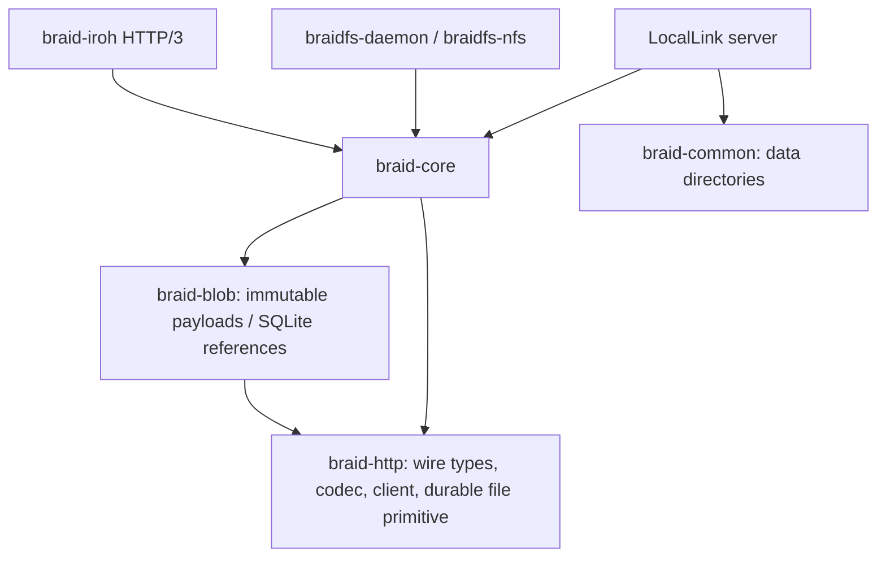

# Architecture and storage contracts

All application crates are members of the root workspace. Dependency direction:

`braid-http` owns Version, Update, Patch, request types and wire framing. Both
native and WASM HTTP paths use its encoder and incremental parser. A native
runtime future must be Send; browser runtime futures may be local. The HTTP
crate forbids unsafe code. OS/runtime adapters own IO and subscription tasks.

`braid-core::replica` validates event identity, parents, merge type, ranges and
representation digest. A per-document process lock serializes load, candidate
mutation, atomic file publication and notification. Event fingerprints make
retries idempotent. Diamond text changes use the declared historical parent
frontier and preserve concurrent heads. Checkpoints contain operation history
and both legacy local positions and stable remote agent/sequence mappings.
The conservative Simpleton commit API rejects stale positional writes. The
Peer-bearing HTTP/H3 profile transforms historical-parent writes through Diamond.
The public legacy resolver stages a whole batch and records one identity only
after every operation succeeds.

HTTP and Iroh H3 call the same replica adapter. Subscriptions subscribe before
loading replay state, send an initial snapshot or valid linear replay, then
publish committed updates through a bounded broadcast. Lag terminates the stream
for frontier-based repair. Simpleton subscribers receive patches relative to their own view, with own-peer
echo suppression and delayed concurrent corrections. Original causal events are
available through finite historical interval GET; they are separate from
positional stream projections.

The shared `braid-http::client::ReliableChannel` actor owns a resource's GET and
serial PUT queue. A durable journal separates received, optimistic and pending
state; reconnect starts at the oldest unacknowledged update's parents. A PUT
failure cancels the GET and vice versa. Retryable network/status failures back
off together; malformed data, authorization and causal conflicts retain state
and stop for repair. There are bounded command, receive and outbox queues, a PUT
timeout, and a native kernel writer lease. A queued identity and its exact bytes survive
an ambiguous ACK. Application state and its queue/cursor commit together.

`JournalBackend` separates that transaction from filesystem dependencies. The
existing `ChannelJournal::open` API adapts `FileJournal` without changing stored
checkpoint fields. Custom backends must hold exclusive writing and acknowledge
`store` only after atomic publication. A failed store leaves the actor's previous
record in memory and returns an error. Recovery after uncertain publication may
see the complete prior record or complete candidate, never a partial transaction.
`OwnedTask` owns abort/join on Tokio or the browser local
executor; shared retry and PUT timers select the corresponding runtime timer.
The same Simpleton owner now compiles in the core `client`/`wasm` profiles.
IndexedDB, browser writer exclusion and actual Fetch cancellation remain open;
compilation alone does not establish durable browser editing.

`braid-core::simpleton` owns scalar text diffs, peer counters, parent checks,
representation digests and offline pending text, following the pinned upstream
client. It uses this channel rather than an independent retry loop. Its revision
comparison guards filesystem decisions against a concurrent receive. The Rust
server's explicit transforming profile is verified with concurrent production
Rust and pinned JavaScript clients, Unicode edits and an accepted PUT whose ACK
is lost. Missing legacy events still require an explicit repair boundary.

The filesystem registry shares one Simpleton client per URL. The daemon owns
scanner, replay, subscription and debouncer workers and cancels/drains them at
shutdown. Debouncing has bounded pending URLs and at most eight workers; the
scanner has entry/depth/queue limits and a cancellation-safe overlap permit.
The channel journal holds a complete application recovery record before local
projection. `file_service` merges the disk and channel changes against the last
materialized view using declared-base Diamond operations. It queues the result
with a revision check before atomic file publication. `VersionStore.materialized`
keeps optimistic bytes separate from server-acknowledged `file_versions`.

A root filesystem lease serializes daemon projections and NFS backing operations
across cooperating processes, without holding it while waiting for a network ACK.
A separate daemon lease prevents two independent JSON/config owners. NFS adapter
calls run on blocking workers under a single permit. Persistent inode IDs are
monotonic. Rename/remove journal a bounded content snapshot before changing the
local namespace, then update descendant inode mappings in one SQLite transaction.
Prepared changes recover on NFS startup; interrupted staging never changes paths.
The daemon reconciles `remote_pending` operations through the same text channels,
using persistent monotonic operation identities. Rename publishes destination
text before an empty source replacement. Local tombstones suppress resurrection;
removed bytes and operation snapshots remain private for recovery. This is an
explicit filesystem policy, not a Braid DELETE extension or atomic remote rename.
Cross-origin destinations require explicit configuration. Unsupported binary
remote operations retain their snapshot and error rather than claiming sync.

Blob uploads stage and hash with a heap-backed 64 KiB buffer, enforce limits,
fsync payloads and publish immutable CAS files before an SQLite transaction names
them. Database work runs on the blocking pool, with a busy timeout. Cancellation
may leave safe unreferenced objects, not a committed missing payload. Historical
payloads are retained; no automatic garbage collection runs. `open` verifies and
rewinds a payload for streaming, while `get` caps buffering at 64 MiB.

Chat rooms keep structured messages, a causal graph and an additive event ledger.
They do not use Diamond text operations to merge message objects. Local and remote
candidate changes are saved before replacing visible memory. Legacy snapshots
retain messages/edits but cannot invent absent event history. A request for that
missing history returns an error. Concurrent edits of the same chat message
require explicit coordination/resolution.

Iroh 1.4.1 owns authenticated QUIC identity and connection lifecycle. H3 handlers
check the authenticated RemoteId against an explicit peer policy (default deny).
Revocation wakes active response streams. Private nodes do not automatically
broadcast resource frontiers to deterministic public gossip topics. Proxy tasks
are owned and cancelled at shutdown. Gossip remains a bounded hint mechanism;
reliable anti-entropy scheduling and relay/network-partition behavior are not yet
proven. Callers must authorize application-level remote chat authors separately.

JSON replica and room stores hold kernel writer leases for their lifetime.
Stateless replica handles in one process share ownership and subscription
broadcasts; another process fails explicitly instead of keeping a stale cache.
Blob metadata and the NFS intention registry use SQLite transactions. Auth and
friends share a bounded SQLite pool using WAL, FULL synchronization, foreign
keys and a busy timeout. Session validation consults the database for every call,
so logout and account deactivation are visible across manager instances; bcrypt
runs on a bounded blocking pool.

These locks cover cooperating services, not arbitrary external editors or
physical power loss. Unix parent directories are synced after atomic replacement;
Windows directory durability and exhaustive crash points require separate tests.

Resource policy lives outside replicated payloads. User and authenticated peer
principals occupy different namespaces. Policies are private by default; missing
legacy ownership denies network access. Creation locks prove data is new before
a request may reserve ownership. A policy writer lease spans data publication;
write generations block adoption rollback after publication starts. Reads check
policy before disclosing history, indexes are filtered, and stream readers
recheck each frame and every second. Blob authority comes from an existing
authorized resource or private upload reference. Attachment insertion must
authorize the reference before it is added to a message. Iroh transport peer
allowlists and per-resource grants are independent checks.

The daemon applies credentials by exact HTTP origin at the request boundary,
separate from immutable Update queues. A successful credential update persists
before publishing the in-memory map and restarts only affected text owners.
Configuration status/debug/error paths redact secrets. Schema-2 migration keeps
original bytes and a versioned hash record; later writes block format rollback.
The application settings bridge holds a Manage-authorized control/daemon policy
permit during its RPC. It distinguishes persisted and pending outcomes and uses
a direct loopback transport without proxies or redirects. Native default clients
also disable redirects so PUT acknowledgments cannot come from redirected GETs.
