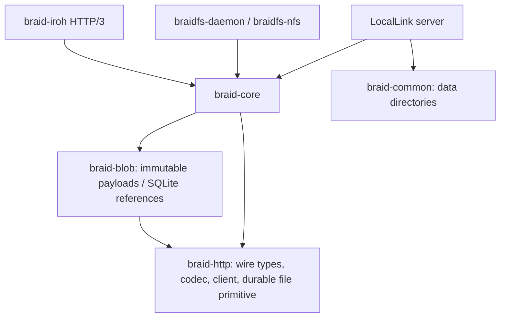

# Architecture and storage contracts

All application crates are members of the root workspace. Dependency direction:

`braid-http` owns Version, Update, Patch, request types and wire framing. Both
native and WASM HTTP paths use its encoder and incremental parser. A native
runtime future must be Send; browser runtime futures may be local. The HTTP
crate forbids unsafe code. OS/runtime adapters own IO and subscription tasks.

`braid-core::replica` validates event identity, parents, merge type, ranges and
representation digest. A per-document process lock serializes load, candidate
mutation, atomic file publication and notification. Event fingerprints make
retries idempotent. Diamond text changes use the declared historical parent
frontier and preserve concurrent heads. Checkpoints contain operation history
and both legacy local positions and stable remote agent/sequence mappings.
Simpleton accepts coordinated writes at the current frontier; a stale positional
write conflicts. The public legacy merge wrappers are a separate compatibility
surface and have not acquired every ReplicaStore guarantee.

HTTP and Iroh H3 call the same replica adapter. Subscriptions subscribe before
loading replay state, send an initial snapshot or valid linear replay, then
publish committed updates through a bounded broadcast. Lag terminates the stream
for frontier-based repair. Concurrent histories use an authoritative merged
snapshot rather than replaying positional patches at the wrong base.

The HTTP reliable client records acknowledged frontiers separately from received
ones. The filesystem adapter retains a durable outbox and materializes files
before acknowledgement. A single shared persistent GET/PUT channel state machine
across every adapter is still outstanding; current code must not be described as
providing that stronger contract.

Blob uploads stage and hash with a heap-backed 64 KiB buffer, enforce limits,
fsync payloads and publish immutable CAS files before an SQLite transaction names
them. Database work runs on the blocking pool, with a busy timeout. Cancellation
may leave safe unreferenced objects, not a committed missing payload. Historical
payloads are retained; no automatic garbage collection runs. `open` verifies and
rewinds a payload for streaming, while `get` caps buffering at 64 MiB.

Chat rooms keep structured messages, a causal graph and an additive event ledger.
They do not use Diamond text operations to merge message objects. Local and remote
candidate changes are saved before replacing visible memory. Legacy snapshots
retain messages/edits but cannot invent absent event history. A request for that
missing history returns an error. Concurrent edits of the same chat message
require explicit coordination/resolution.

Iroh 1.4.1 owns authenticated QUIC identity and connection lifecycle. H3 handlers
check the authenticated RemoteId against an explicit peer policy (default deny).
Revocation wakes active response streams. Private nodes do not automatically
broadcast resource frontiers to deterministic public gossip topics. Proxy tasks
are owned and cancelled at shutdown. Gossip remains a bounded hint mechanism;
reliable anti-entropy scheduling and relay/network-partition behavior are not yet
proven. Callers must authorize application-level remote chat authors separately.

JSON replica/room stores currently assume one writer process per data directory.
Blob metadata uses SQLite transactions; Iroh identity generation additionally
uses an OS file lock. These guarantees are distinct. Windows file replacement,
Linux directory fsync and physical power loss require platform-specific testing.
