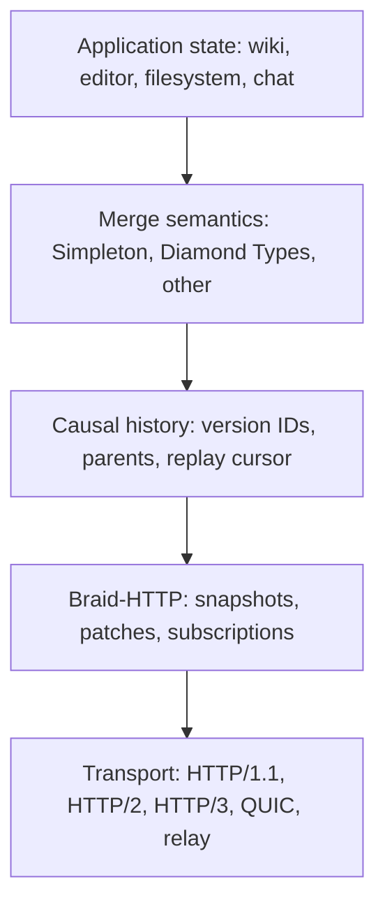
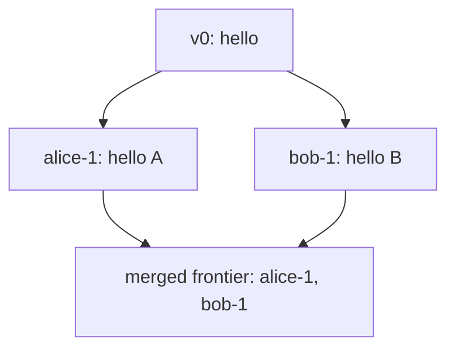
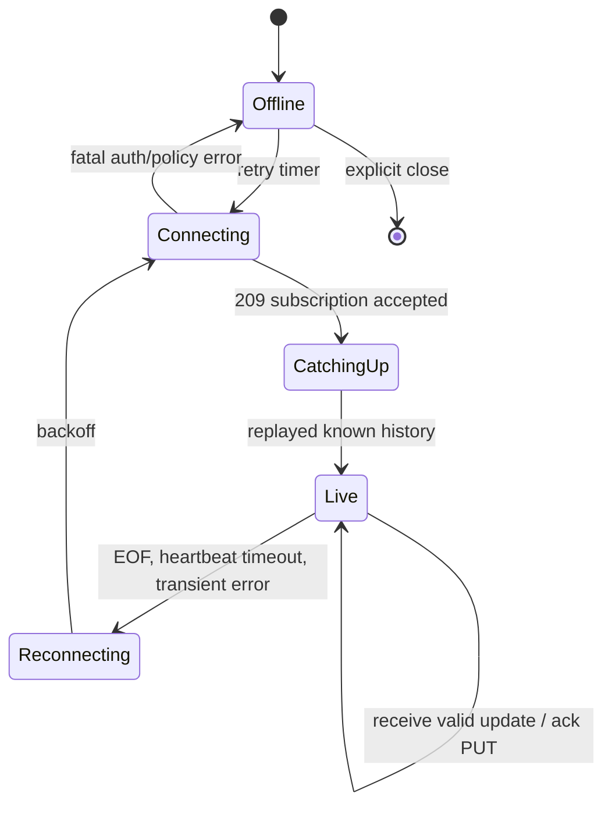
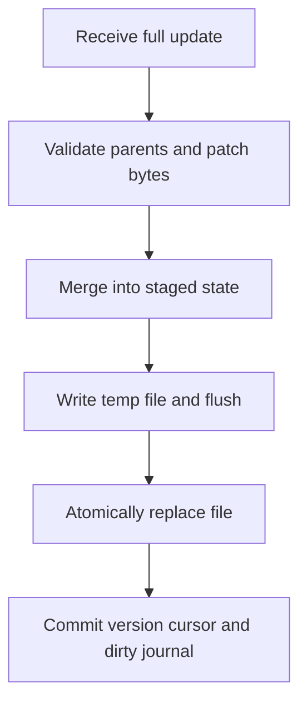
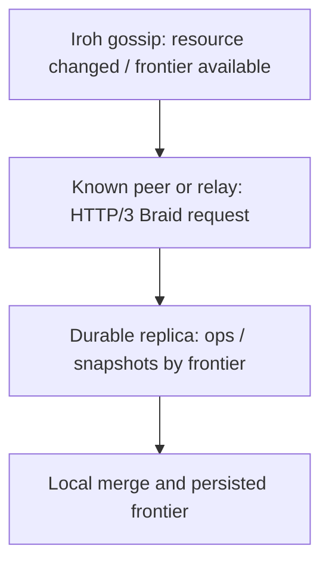
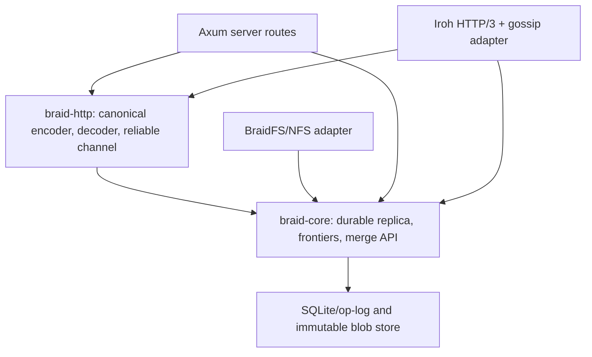

# Braid Reborn: protocol, Rust implementation, correctness audit, and upgrade plan

**Repository:** [`trilltino/braid-reborn`](https://github.com/trilltino/braid-reborn)  
**Reviewed revision:** [`47e4f2c0b0953c01f059e9ba531ec7bfd63d8dfc`](https://github.com/trilltino/braid-reborn/tree/47e4f2c0b0953c01f059e9ba531ec7bfd63d8dfc), dated 3 March 2026  
**Review date:** 22 October 2026  
**Reference revisions:** `braid-spec` [`0541922`](https://github.com/braid-org/braid-spec/tree/0541922135bea0d60ad6b539e8d1ec25c2527284), `braid-http` [`639b811`](https://github.com/braid-org/braid-http/tree/639b811ec91e5d1aae4a4a7d162616b499f95b07), `braid-text` [`1b50ed3`](https://github.com/braid-org/braid-text/tree/1b50ed357dcbbf59a1f4554690f69d0458bc967e), `braid-fuzz` [`b79c23f`](https://github.com/braid-org/braid-fuzz/tree/b79c23f877d2e6807e3925bc0165a4da139a4458), `braidfs` [`c54447f`](https://github.com/braid-org/braidfs/tree/c54447f09016f9934ead1cb4bf277a945e5093fb).

> **Review boundary.** This is a source audit, not a successful build certification or a proof of exploitable vulnerabilities. I cloned the named revisions, read the actual Rust implementation and the upstream code and drafts, and followed key call chains. The execution environment did not have `cargo`, and the repository checkout itself has an unresolved `braid-common` gitlink, so no Rust compilation, test suite, network integration test, or benchmark result is claimed. Statements below use **Confirmed by source**, **Likely risk**, or **Proposal** deliberately. I cannot establish which commits or lines you personally authored, or whether the code was assisted by AI, from this snapshot alone.

## 1. Executive judgement

Your project has the breadth of a serious systems integration experiment: typed HTTP messages, incremental response parsing, per-document merge engines, a Rust Diamond Types wrapper, a filesystem daemon, content-hash verification, NFS, a server, and Iroh QUIC/gossip transport. You understand the *components* of Braid and have worked across several difficult Rust domains. The important missing part is a single, tested **correctness model** linking those components.

The largest problems are not micro-optimizations. Several current paths can silently omit edits, discard causal information, accept incomplete streams, or overwrite unsent work. A faster CRDT will not repair that. Treat *wire conformance*, *durable causal history*, and *lossless offline recovery* as prerequisites for making any performance claim.

### 1.1 Findings ranked by consequence

| ID | Priority | Finding | Consequence | Evidence |
|---|---|---|---|---|
| F01 | **P0** | `BraidRequest.patches` is not serialized by the native `fetch` path, while BraidFS sends its text edits through `with_patches`. | A purported successful PUT can have no patch body and no patch framing. Local code may treat a 2xx response as an acknowledged edit. | [request.rs L75-77](https://github.com/trilltino/braid-reborn/blob/47e4f2c0b0953c01f059e9ba531ec7bfd63d8dfc/braid-http/src/types/request.rs#L75-L77), [native_network.rs L25-115](https://github.com/trilltino/braid-reborn/blob/47e4f2c0b0953c01f059e9ba531ec7bfd63d8dfc/braid-http/src/client/native_network.rs#L25-L115), [sync.rs L227-266](https://github.com/trilltino/braid-reborn/blob/47e4f2c0b0953c01f059e9ba531ec7bfd63d8dfc/braid-core/src/fs/sync.rs#L227-L266) |
| F02 | **P0** | BraidFS resolves an unknown-parent/content difference by writing the server copy over the local file and returning before sending the edit. | Offline local changes can disappear. | [sync.rs L28-108](https://github.com/trilltino/braid-reborn/blob/47e4f2c0b0953c01f059e9ba531ec7bfd63d8dfc/braid-core/src/fs/sync.rs#L28-L108) |
| F03 | **P0** | Server implementations put JSON into the `Patches` **header** or format it as a JSON value, whereas Braid defines `Patches: N` and a body containing individually framed patches. | Upstream Braid clients cannot reliably parse your claimed multipatch traffic. | [handlers_v2.rs L197-209](https://github.com/trilltino/braid-reborn/blob/47e4f2c0b0953c01f059e9ba531ec7bfd63d8dfc/server/src/core/pages/handlers_v2.rs#L197-L209), [L334-366](https://github.com/trilltino/braid-reborn/blob/47e4f2c0b0953c01f059e9ba531ec7bfd63d8dfc/server/src/core/pages/handlers_v2.rs#L334-L366), [Braid-HTTP draft §3.3](https://github.com/braid-org/braid-spec/blob/0541922135bea0d60ad6b539e8d1ec25c2527284/draft-toomim-httpbis-braid-http-04.txt) |
| F04 | **P0** | A fresh clone contains an empty `braid-common` gitlink, no `.gitmodules` mapping, yet the workspace and server depend on it. | Reproducible builds are blocked until an independently sourced directory is supplied. | [workspace manifest](https://github.com/trilltino/braid-reborn/blob/47e4f2c0b0953c01f059e9ba531ec7bfd63d8dfc/Cargo.toml#L1-L16), [server manifest](https://github.com/trilltino/braid-reborn/blob/47e4f2c0b0953c01f059e9ba531ec7bfd63d8dfc/server/Cargo.toml#L54), git tree entry `160000 0c56cf5` with no `.gitmodules` |
| F05 | **P1** | Incoming `Current-Version` is used as the update's version in preference to `Version`, and multiple version IDs are reduced to the last one. | A version frontier becomes a fabricated scalar; catch-up and concurrent history lose meaning. | [utils.rs L58-107](https://github.com/trilltino/braid-reborn/blob/47e4f2c0b0953c01f059e9ba531ec7bfd63d8dfc/braid-http/src/client/utils.rs#L58-L107) |
| F06 | **P1** | The Rust Diamond merge wrapper returns a newly produced version as the *parent* of its own local edit. It also uses UTF-8 byte length as a character end index. | Invalid ancestry and potential Unicode-index panics/incorrect edits. | [diamond.rs L757-765, L850-895](https://github.com/trilltino/braid-reborn/blob/47e4f2c0b0953c01f059e9ba531ec7bfd63d8dfc/braid-core/src/core/merge/diamond.rs#L757-L895) |
| F07 | **P1** | The server CRDT's `get_history` explicitly returns unavailable, and a separate JSON-backed graph stores version-to-parent edges without durable CRDT operation history. | Reconnects cannot reliably request or replay missing operations; stale-peer convergence is unproven. | [resource_state.rs L282-289](https://github.com/trilltino/braid-reborn/blob/47e4f2c0b0953c01f059e9ba531ec7bfd63d8dfc/braid-core/src/core/server/resource_state.rs#L282-L289), [versioned_storage.rs L23-40, L178-217](https://github.com/trilltino/braid-reborn/blob/47e4f2c0b0953c01f059e9ba531ec7bfd63d8dfc/server/src/core/pages/versioned_storage.rs#L23-L40) |
| F08 | **P1** | The Braid response parser has no specified frame size limits, tolerates malformed `Patches` by silently interpreting it as zero, and the subscription turns binary snapshots into lossy UTF-8 strings. | Memory exhaustion, stream desynchronization, and corrupted binary content. | [parser.rs L93-190, L240-299](https://github.com/trilltino/braid-reborn/blob/47e4f2c0b0953c01f059e9ba531ec7bfd63d8dfc/braid-http/src/client/parser.rs#L93-L299), [utils.rs L72-77](https://github.com/trilltino/braid-reborn/blob/47e4f2c0b0953c01f059e9ba531ec7bfd63d8dfc/braid-http/src/client/utils.rs#L72-L77) |
| F09 | **P1** | The Iroh GET subscription sends a *single* 209 response with serialized JSON, not a continuing Braid update stream. The PUT handler ignores causal `Parents` and merges. | P2P transport exists, but the Iroh endpoint is not yet a conforming or convergent Braid replica. | [iroh protocol.rs L49-194](https://github.com/trilltino/braid-reborn/blob/47e4f2c0b0953c01f059e9ba531ec7bfd63d8dfc/braid-iroh/src/protocol.rs#L49-L194) |
| F10 | **P1** | There is no unified lifetime for GET subscription, queued PUTs, acknowledgements, resubscription frontier, and heartbeats. | Retrying can duplicate writes, lose outstanding edits, or reconnect from an obsolete state. | [fetch.rs L140-227](https://github.com/trilltino/braid-reborn/blob/47e4f2c0b0953c01f059e9ba531ec7bfd63d8dfc/braid-http/src/client/fetch.rs#L140-L227), [native_network.rs L117-273](https://github.com/trilltino/braid-reborn/blob/47e4f2c0b0953c01f059e9ba531ec7bfd63d8dfc/braid-http/src/client/native_network.rs#L117-L273), [upstream reliable channel](https://github.com/braid-org/braid-http/blob/639b811ec91e5d1aae4a4a7d162616b499f95b07/braid-http-client.js#L1967-L2162) |
| F11 | **P1** | Non-atomic JSON saves plus read/modify/write without per-page serialization can lose concurrent mutations and recover partial files. | Server version histories may be truncated or overwritten after a crash or two racing PUTs. | [versioned_storage.rs L109-165](https://github.com/trilltino/braid-reborn/blob/47e4f2c0b0953c01f059e9ba531ec7bfd63d8dfc/server/src/core/pages/versioned_storage.rs#L109-L165), [handlers_v2.rs L163-290](https://github.com/trilltino/braid-reborn/blob/47e4f2c0b0953c01f059e9ba531ec7bfd63d8dfc/server/src/core/pages/handlers_v2.rs#L163-L290) |
| F12 | **P1** | The repo advertises WASM network support, but both WASM network methods return "not implemented yet." | The public API compiles conditionally but a browser-client transport does not exist. | [wasm_network.rs L1-25](https://github.com/trilltino/braid-reborn/blob/47e4f2c0b0953c01f059e9ba531ec7bfd63d8dfc/braid-http/src/client/wasm_network.rs#L1-L25) |
| F13 | **P2** | The native client forces HTTP/1.1, sends `Connection: close` even for normal fetches, and constructs a multiplex key that omits the URL's port. | Pooling is wasted; same-host different-port multiplex connections can be mixed; native HTTP/2 is disabled. | [fetch.rs L53-68, L352-359](https://github.com/trilltino/braid-reborn/blob/47e4f2c0b0953c01f059e9ba531ec7bfd63d8dfc/braid-http/src/client/fetch.rs#L53-L68), [native_network.rs L89-95](https://github.com/trilltino/braid-reborn/blob/47e4f2c0b0953c01f059e9ba531ec7bfd63d8dfc/braid-http/src/client/native_network.rs#L89-L95) |
| F14 | **P2** | `braid-blob` hashes/validates content, but uses version-string ordering and writes file and metadata in separate steps. | The integrity feature is useful, but does not produce causal reconciliation or a transaction spanning file and index. | [store.rs L68-185](https://github.com/trilltino/braid-reborn/blob/47e4f2c0b0953c01f059e9ba531ec7bfd63d8dfc/braid-blob/src/store.rs#L68-L185) |
| F15 | **P2** | Testing concentrates on helpers and a few integrity cases, without upstream Braid-Fuzz controller, fault-injection suite, or CI workflows in the checked-out tree. | Core reliability claims have no end-to-end automated evidence. | [`braid-fuzz`](https://github.com/braid-org/braid-fuzz/tree/b79c23f877d2e6807e3925bc0165a4da139a4458), repository `braid-core/tests`, `server/tests`, no `.github` at reviewed revision |

**Fix order:** F04 to make the tree reproducible; F01/F03/F05 to move wire data faithfully; F02/F06/F07/F11 to preserve edits and causal history; F08/F10 for robust streaming; F09 for P2P parity; then performance and extended features. It is reasonable to classify F01-F04 as release blockers for any promise of reliable, interoperable sync.

### 1.2 The most important distinction

`braid-reborn` contains *some of* each layer, but it does not yet guarantee the cross-layer invariant:

> Every committed edit has a unique identity and the correct parents; any peer that reconnects from a previously acknowledged frontier can obtain the missing operations or a valid replacement snapshot; concurrent updates merge or are explicitly rejected; no acknowledged edit is silently forgotten.

That is the real contract to build and test. Braid HTTP provides the vocabulary for communicating it. Diamond Types provides one merge mechanism for text. Neither the header parser nor CRDT library by itself guarantees it.

---

## 2. What Braid actually is

### 2.1 HTTP state transfer versus HTTP state synchronization

Conventional HTTP GET normally answers "what is `/note` now?" Braid adds a second dimension: "what happened to `/note` after the version I know, and can I remain subscribed to future changes?"

The Braid layer is **a set of HTTP extensions for naming causal versions, transporting patches, and subscribing to successive updates**. It does not require one storage engine, one CRDT, or one network topology. An ordinary HTTP server may implement a plain snapshot; a richer Braid peer can track a version DAG, send deltas, and merge offline edits. A relay can forward updates, but a relay alone does not make changes converge.

Conceptual layers:



Do not conflate protocol and merge algorithm:

| Layer | Responsibility | Example failure it should prevent |
|---|---|---|
| HTTP framing | Exactly reconstruct bytes and patch boundaries | Half a patch treated as a full edit |
| Version graph | Establish causal precedence/concurrency | Mistaking a concurrent edit for an older edit |
| Merge algorithm | Produce deterministic state for concurrent operations | Different peers resolving the same edits differently |
| Reliable channel | Resume, retry, acknowledge, time out | Lost edit during a disconnect |
| Durable store | Recover after restart | Acknowledged edit disappears when server crashes |
| Filesystem adapter | Convert file saves to and from versioned edits | Local unsent edit overwritten by remote refresh |

The relevant draft is [`draft-toomim-httpbis-braid-http-04.txt`](https://github.com/braid-org/braid-spec/blob/0541922135bea0d60ad6b539e8d1ec25c2527284/draft-toomim-httpbis-braid-http-04.txt), especially §§2-4. There are also separate draft texts for [`Versions -05`](https://github.com/braid-org/braid-spec/blob/0541922135bea0d60ad6b539e8d1ec25c2527284/draft-toomim-httpbis-versions-05.txt), [`Range-Patch -01`](https://github.com/braid-org/braid-spec/blob/0541922135bea0d60ad6b539e8d1ec25c2527284/draft-toomim-httpbis-range-patch-01.txt), [`Merge Types`](https://github.com/braid-org/braid-spec/blob/0541922135bea0d60ad6b539e8d1ec25c2527284/draft-toomim-httpbis-merge-types-00.txt), and [Linked JSON](https://github.com/braid-org/braid-spec/blob/0541922135bea0d60ad6b539e8d1ec25c2527284/draft-toomim-httpbis-linked-json-00.txt). These are evolving Internet-Draft proposals and community conventions, **not a published IETF Braid RFC**. The drafts and upstream runtime code do not always describe the same newest behavior, so record which compatibility profile you are implementing.

### 2.2 Versions are causal *frontiers*, not timestamps

Consider the sequence:



Alice and Bob both edit after `v0` while disconnected. Neither edit is "later" just because its ID has a larger integer or its wall clock is ahead. The versions are **concurrent**. A Braid `Version` field can contain a set of IDs representing a frontier of a causal DAG; `Parents` identifies the causal predecessor frontier of a mutation. The strings are IDs, not numeric timestamps unless a particular merge/version type gives them additional meaning. The Versions -05 draft explains this explicitly.

Example update:

```http
PUT /notes/roadmap HTTP/1.1
Host: sync.example
Version: "alice-17"
Parents: "bob-9", "alice-16"
Merge-Type: simpleton
Patches: 1

Content-Range: text [5:5]
Content-Length: 1

!
```

Here `Version: alice-17` labels this **new** edit. `Parents` tells the receiver the causal state on which the edit was based, not the versions generated by that edit. A receiver must understand both parent IDs, obtain missing history, or explicitly reject/defer the operation. It must not simply sort `alice-17` and `bob-9` lexically and pick the winner.

In Rust, this is why the public `Update` type's `version: Vec<Version>` and `parents: Vec<Version>` are a sensible starting point [`braid-http/src/types/update.rs`](https://github.com/trilltino/braid-reborn/blob/47e4f2c0b0953c01f059e9ba531ec7bfd63d8dfc/braid-http/src/types/update.rs#L7-L32). The problem is that downstream code throws away the set, overwrites parent relationships, and sometimes reduces revisions to ordinal counters.

### 2.3 Snapshots and patches

A **snapshot** says "this is the state". A **patch** says "apply this change relative to a known state". Braid transports both.

Snapshot in a response:

```http
HTTP/1.1 200 OK
Version: "alice-7"
Merge-Type: simpleton
Content-Type: text/plain
Content-Length: 5

hello
```

A subscribed response carries more than one framed update in the response body. The current upstream uses status **209** for that long-running multiresponse:

```http
HTTP/1.1 209 Subscription
Subscribe: true
Merge-Type: simpleton

Version: "alice-7"
Parents:
Content-Length: 5

hello
Version: "bob-8"
Parents: "alice-7"
Patches: 1

Content-Range: text [5:5]
Content-Length: 1

!
```

The blank line after subscription response headers separates HTTP-level headers from the sequence of in-body Braid update frames. Transport chunks have no relationship to frames: one TCP chunk may hold a partial header, half a UTF-8 character, an entire patch, or multiple complete updates. Your parser must incrementally buffer only the bytes needed to reach a complete frame.

Crucial detail: `Patches: 1` is **a decimal count**. It is not a JSON array. For each patch, an inner set of headers gives `Content-Range`, `Content-Length`, and optionally `Content-Type`. The raw patch bytes follow. If there are multiple patches in an update, their ranges refer to the **original** document positions; applying them sequentially requires an accumulated shift. See the current upstream [Simpleton patch contract](https://github.com/braid-org/braid-text/blob/1b50ed357dcbbf59a1f4554690f69d0458bc967e/client/simpleton.js#L8-L31).

`Content-Range` has units. For a text patch, `text [i:j]` ordinarily denotes Unicode *code-point* positions with an exclusive right endpoint. These are not Rust byte offsets. A UTF-8 string can have 7 bytes but 3 Unicode scalar values. Likewise, browser textareas use UTF-16 code units; a JS editor adapter must translate between UTF-16 and wire code-point indices.

### 2.4 Subscription semantics and a reconnect cursor

`GET /note` with `Subscribe: true` asks for a stream of changes. The client may send `Parents` to resume from the last known frontier. The server can then emit changes *after* that frontier. A one-time `GET` with `Version` asks for the resource at that specific historical version. A request with both `Version` and `Parents` can select an interval of history. The HTTP draft explicitly forbids a `Version` header in a subscribed GET and defines special rules for missing historical versions.

An update can contain `Current-Version` in addition to its own `Version`: the former tells the client where the *server's latest frontier* is, useful during catch-up. It does **not** replace the version ID of an update being replayed. This is precisely the error in `message_to_update` described later.

One reliable implementation flow:



This is not just "retry GET on error". The local change queue, subscription frontier, unacknowledged PUTs, timeouts, and duplicate filtering must all survive a connection restart as one coordinated unit. Current upstream [`reliable_update_channel`](https://github.com/braid-org/braid-http/blob/639b811ec91e5d1aae4a4a7d162616b499f95b07/braid-http-client.js#L1967-L2162) has exactly this coordination.

### 2.5 Simpleton is intentionally asymmetric

The [Simpleton protocol](https://braid.org/protocol/simpleton) is a protocol profile in which a client can keep only the current text and frontier. The server is responsible for history transformation or rebase when necessary. Simpleton is *not* a standalone CRDT that safely merges arbitrary concurrent position patches without knowing their ancestry.

The upstream client keeps:

```text
client_state     text at the last locally accepted version
client_version   current causal frontier
pending_state    most recent unsent local text, if dirty
outstanding_puts count of edits awaiting acknowledgement
peer             identity for outgoing version IDs and echo filtering
```

On local input, it computes a minimal patch from `client_state` to the new state. It assigns a unique version, records its **old** frontier as parents, updates its optimistic state, and queues the PUT. When offline or there are too many outstanding operations, it coalesces further edits into `pending_state`. During catch-up it accepts only updates whose `Parents` match the state it expects. See [`simpleton.js` L75-163](https://github.com/braid-org/braid-text/blob/1b50ed357dcbbf59a1f4554690f69d0458bc967e/client/simpleton.js#L75-L163).

Why this matters: a filesystem watcher can fire twenty times while a user saves a file; those are not necessarily twenty independent causal edits. A well-designed sync loop accumulates local changes, sends when its parents are known and the channel is ready, and preserves unsent content through reconnect. The server can merge different authors' causal operations with Diamond Types and send rebased text patches back to Simpleton clients.

### 2.6 Diamond Types provides the internal causal operation model

Diamond Types represents text changes as operations with agent IDs, agent-relative sequence numbers, and causal dependencies. Two important internal objects are the **OpLog**, storing operations and their graph, and a **Branch**, materializing the visible text at a chosen frontier. The library provides position transformations for concurrent edits, binary serialized operations, and history/frontier handling. The upstream [internals document](https://github.com/josephg/diamond-types/blob/master/INTERNALS.md) explains agent-sequence IDs, spatial positions, and causality.

Your `DiamondCRDT` wrapper maps reasonably to those concepts:

| Braid concept | Your Rust symbol | Intended meaning |
|---|---|---|
| CRDT operation log | `DiamondCRDT.oplog` | All known text operations |
| Materialized text | `DiamondCRDT.branch` | Visible text after merging a frontier |
| Local author's identity | `DiamondCRDT.agent_id` | Agent component in unique operation IDs |
| Causal frontier | `oplog.cg.version` | Current local causal heads |
| Braid ID to CRDT causal time | `version_fronties: HashMap<String, Frontier>` | Translate wire IDs to internal parents |
| Text object | `text_id` | ID of a root-map `content` text object |
| Incoming positional edit | `add_insert_remote_versioned` / `add_delete_remote_versioned` | Convert a wire edit at its causal parents to a DT op |

The mapping is promising. The implementation weakens it by returning operations with unresolved parents as if they were valid, holding version mappings only in RAM, generating scalar version strings from local log lengths, and re-creating a new merge engine from visible content on every `v2` PUT. Fix those semantics before chasing the upstream library's raw throughput.

### 2.7 Braid is not intrinsically P2P, and Iroh is not intrinsically Braid

Iroh solves endpoint identity, QUIC connections, peer discovery, and network reachability. Iroh-gossip disseminates small messages on topics. Braid defines an application protocol *above* that transport: IDs, parents, change framing, history requests, convergence, and replay. A deterministic gossip topic derived from a resource URL is a discovery/routing technique, not an authorization policy or a durability mechanism.

Your transport direction is sensible. It also creates extra requirements: peers joining late need state transfer; dropped gossip messages need repair; partitions need reconciliation; unauthenticated peers must not write private documents; and a 209 response still needs correct streaming semantics when transported over HTTP/3.

### 2.8 Time Machines and filesystem sync

[BraidFS](https://github.com/braid-org/braidfs) and [Time Machines](https://braid.org/time-machines) try to make ordinary file editors participate in collaborative causal history. A plain editor saves a whole file; the sync layer must compare it against the correct historical local base, produce patches with correct parents, and rebase local work around remote changes. "Server wins" is a policy that **throws one side away**, not a conflict-free merge. This matters far more for an NFS bridge because write ordering and file-close semantics are less explicit than a browser textarea's input event.

---

## 3. What the repository has, and what actually runs

### 3.1 Workspace structure

| Crate/component | Strength already visible | Boundary or gap |
|---|---|---|
| `braid-http` | Separate typed versions, patches, requests, responses; incremental parser; native client; retry and multiplex modules | Network sender drops patches; framing rules are incomplete; WASM transport is stubbed |
| `braid-core/src/core` | Merge-type trait, Simpleton implementation, Diamond Types wrapper, server resource registry and middleware | Version/protocol invariants do not survive across implementations; history endpoint unavailable |
| `braid-core/src/vendor/diamond_types` | Embeds substantial upstream-style optimized CRDT implementation | Vendoring makes upgrades and attribution difficult; this code is not evidence of your own original CRDT algorithm work |
| `braid-core/src/fs` | Mapping, watcher/daemon state, local HTTP server, subscriptions, file sync, NFS and binary sync paths | Overwrite-on-conflict, patch omission, update-version-before-apply, incomplete crash recovery |
| `braid-blob` | SQLite metadata, SHA-256 hash verification on reads, atomic file-writing helper | Versions ordered lexically; file/index writes lack a common recovery transaction |
| `braid-iroh` | QUIC endpoint/router, Axum over HTTP/3, deterministic gossip topics, peer discovery and TCP proxy | Iroh HTTP handlers are demonstration-grade state store; no causal merge/replay; unsafe default identities |
| `braidfs-daemon` / `braidfs-nfs` | Entry points for filesystem and NFS use | Need measured semantics for write buffering, rename, flush, retry, and error propagation |
| `server` | Auth infrastructure, chat CRDT, wiki/page APIs, subscription fanout | Multiple incompatible wire formats; page store and CRDT state disagree on history guarantees |
| `braid-common` | Referenced by multiple manifests | Gitlink without `.gitmodules` prevents reproducible checkout |
| `references/iroh-gossip`, `references/iroh-h3` | Local path integrations that may permit custom behavior | Fork drift/maintenance burden and substantial compiled surface |

The distinction between **declared** and **implemented** features matters. The README's "WASM support" is a compile-time module containing two methods that return errors; the P2P read handler's 209 response is not a subscription stream; and "full version graph support" in the page store means a JSON parent map, not persistent CRDT operations.

### 3.2 The critical path through your Rust code

For a file save:

```text
filesystem watcher
  -> braid-core/fs/sync.rs::sync_local_to_remote
  -> SimpletonMergeType::local_edit("everything")
  -> BraidRequest::with_patches(Vec<Patch>)
  -> BraidClient::fetch / retry state
  -> NativeNetwork::fetch
  -> reqwest PUT, but patches never serialized
  -> response status 2xx
  -> local cache + version store advance
```

In the opposite direction:

```text
GET Subscribe: true
  -> NativeNetwork::subscribe
  -> response.bytes_stream()
  -> MessageParser::feed
  -> utils::message_to_update
  -> bounded channel of Update
  -> braid-core/fs/subscription.rs
  -> update version store
  -> apply Simpleton/Diamond patch or replace file
```

Look at where the version store moves in the second path: `subscription.rs` updates and saves it at [L264-270](https://github.com/trilltino/braid-reborn/blob/47e4f2c0b0953c01f059e9ba531ec7bfd63d8dfc/braid-core/src/fs/subscription.rs#L264-L270), *before* decoding/applying patches and *before* verifying disk write success. That is the wrong acknowledgment boundary. A merge failure at [L407-420](https://github.com/trilltino/braid-reborn/blob/47e4f2c0b0953c01f059e9ba531ec7bfd63d8dfc/braid-core/src/fs/subscription.rs#L407-L420) leaves a durable cursor claiming an update that did not commit. On reconnect, a server can skip the change because the client advertised it as known. This is an additional serious **P1 correctness bug**.

### 3.3 Where your implementation branches away from upstream

The upstream architecture tends to have one coherent Braid-HTTP framing engine and a reliable channel, with Braid-Text responsible for the particular text merge profile. In the Rust workspace, multiple modules separately implement pieces of wire formatting:

- `braid-http/src/protocol/formatter.rs` produces the numeric `Patches: N` structure, though not every optional header is preserved.
- `server/src/core/pages/handlers.rs` serializes patch vectors as JSON *snapshot bodies*.
- `server/src/core/pages/handlers_v2.rs` writes `Patches: [JSON array]`, incompatible with `Patches: N`.
- `braid-iroh/src/protocol.rs` sends JSON-serialized `Update` objects directly, not Braid update frames.
- `braid-http/src/client/native_network.rs` constructs PUTs independently of the common formatter and does not use `request.patches`.

Each variant can appear to work when the matching peer expects the same bespoke format. Interoperability is established only when a current upstream client and an independent conformance suite can parse and apply the same traffic.

### 3.4 Why a pinned dependency and a working CI job are part of protocol quality

A fresh clone needs to be reproducible without guessing the source of `braid-common`. The root manifest includes that directory; the tracked tree records it as a gitlink; there is no `.gitmodules` mapping. The first repair is mechanical but important: either make `braid-common` an ordinary tracked crate or add a valid submodule URL and document `git submodule update --init --recursive`. Decide whether the two vendored Iroh forks are path dependencies that must be included in all builds, or independent release artifacts. Add a `cargo check --locked --workspace` job and a small isolated `cargo test -p braid-http --locked` job, followed by target-specific `wasm32` checks. No performance work is meaningful when an outside reviewer cannot produce the binaries.

---

## 4. Deep audit: wire parsing, formatting, and byte fidelity

### 4.1 Fix the wire representation first (F01, F03)

**Confirmed by source.** `BraidRequest::with_patches` stores a `Vec<Patch>`, then `sync_local_to_remote` builds it with `Patch { unit: "json", range: "[start:end]", content, ... }`. That outgoing request reaches `NativeNetwork::fetch`, which sends `request.extra_headers`, `request.body`, `Version`, `Parents`, `Subscribe`, `Peer`, and `Merge-Type`. There is no branch using `request.patches`. The patch data has been lost before reqwest starts the HTTP request. The function does not itself require a non-empty body for PUT, so it can send an empty PUT with a seemingly legitimate version identifier.

This is the immediate repair contract:

```rust
// Design sketch: common outgoing-body preparation, shared by native and WASM.
// The exact signatures should be adapted to your existing BraidError type.

struct PreparedBody {
    content_type: Option<String>,
    content_range: Option<String>,
    patches_count: Option<usize>,
    bytes: bytes::Bytes,
}

fn prepare_outgoing(req: &BraidRequest) -> Result<PreparedBody, BraidError> {
    match (&req.patches, req.body.is_empty()) {
        (Some(patches), false) if !patches.is_empty() => {
            Err(BraidError::Protocol("body and patches are mutually exclusive".into()))
        }
        (Some(patches), _) if !patches.is_empty() => {
            let mut body = bytes::BytesMut::new();
            for patch in patches {
                patch.validate()?;
                // Validate patch.unit and patch.range against CR/LF injection.
                // Enforce max patches and max bytes before this allocation.
                let len = patch.content.len();
                body.extend_from_slice(format!(
                    "Content-Range: {} {}\r\nContent-Length: {}\r\n\r\n",
                    patch.unit, patch.range, len
                ).as_bytes());
                body.extend_from_slice(&patch.content);
                // The next patch starts immediately after exactly len bytes.
                // Do not treat a transport chunk boundary as a separator.
            }
            Ok(PreparedBody {
                content_type: None,
                content_range: None,
                patches_count: Some(patches.len()),
                bytes: body.freeze(),
            })
        }
        (Some(_), _) => Err(BraidError::Protocol("empty patch batch".into())),
        (None, _) => Ok(PreparedBody {
            content_type: req.content_type.clone(),
            content_range: None,
            patches_count: None,
            bytes: req.body.clone(),
        }),
    }
}
```

The formatter in [`braid-http/src/protocol/formatter.rs`](https://github.com/trilltino/braid-reborn/blob/47e4f2c0b0953c01f059e9ba531ec7bfd63d8dfc/braid-http/src/protocol/formatter.rs#L24-L91) is already closer to the draft than the network sender: it knows how to put `Patches: N` followed by framed patch headers and content. Reuse one encoder for both sending and server subscriptions, and have exactly one decoder for both. The code above illustrates the invariant; whether you choose a byte buffer or an async streaming `Body` is a performance decision *after* conformance.

For example, the server currently tries:

```http
Patches: [{"range":"[1:2]","content":"X"}]
Content-Length: 10

...content...
```

The Braid patch parser expects:

```http
Patches: 1

Content-Range: text [1:2]
Content-Length: 1

X
```

The protocol has no obligation to understand the first form. In fact, your own parser reads the `Patches` header as a `usize` using `.parse().unwrap_or(0)`. Thus **your client would interpret your own v2 server's JSON Patches header as zero patches**. This is a direct, local cross-module incompatibility, not merely a difference of style.

Choose one canonical representation and add golden-frame tests. The parser and formatter should round-trip:

- one snapshot, including an empty snapshot;
- a single patch with zero-length insertion or deletion;
- multiple patches with absolute pre-update ranges;
- a body containing `\r\n\r\n` and arbitrary `0x00` bytes;
- a `Content-Range` field in a full HTTP response;
- a `Version` frontier with two IDs;
- optional `Current-Version`, `Repr-Type`, and `Repr-Digest` preserved without substituting them for `Version`.

### 4.2 Build a bounded incremental parser (F08)

The `MessageParser` uses a growing `BytesMut`. A malicious server can send a never-terminated header, an oversized `Content-Length`, or a `Patches` count that never finishes, and the code does not enforce maximum header/frame/patch sizes. `find_header_end` searches for four bytes `\r\n\r\n` on each feed; repeatedly rescanning the growing buffer can also become quadratic under adversarial fragmentation. Parsing a claimed patch count via `.unwrap_or(0)` discards malformed input instead of rejecting it. See [`parser.rs`](https://github.com/trilltino/braid-reborn/blob/47e4f2c0b0953c01f059e9ba531ec7bfd63d8dfc/braid-http/src/client/parser.rs#L93-L299).

A resilient parser should maintain a finite state with explicit caps:

```rust
#[derive(Debug, Clone, Copy)]
struct WireLimits {
    max_header_bytes: usize,   // e.g. 32 KiB; tune with interoperability tests
    max_patch_count: usize,    // e.g. 256
    max_patch_bytes: usize,    // e.g. 16 MiB for text, not necessarily blobs
    max_update_bytes: usize,   // e.g. 32 MiB
}

enum FrameState {
    Headers,
    Snapshot { remaining: usize },
    PatchHeaders { remaining_patches: usize },
    PatchBytes { remaining: usize, remaining_patches: usize },
}

fn parse_patch_count(raw: &str, limit: usize) -> Result<usize, BraidError> {
    let n: usize = raw.parse().map_err(|_| {
        BraidError::HeaderParse("Patches must contain a decimal count".into())
    })?;
    if n > limit {
        return Err(BraidError::Protocol("too many patches".into()));
    }
    Ok(n)
}
```

The sample limits are **proposed defaults, not values from the Braid spec**. Make them configurable by deployment. An 8 GiB binary resource should use a separate streaming blob path, not a raised global text-update cap.

The parser should distinguish:

1. Outer HTTP response headers, parsed by reqwest/hyper, from Braid update headers inside a 209 response.
2. A *complete* frame versus a paused but valid partial frame.
3. A server-disconnect EOF after a complete frame versus EOF in the middle of an announced `Content-Length`.
4. An ordinary snapshot body versus a multiresponse header block with its own `Patches` count.
5. A protocol failure requiring full rebootstrap versus an expected transport interruption eligible for retry.

Useful invariants in parser tests:

```rust
// Pseudocode: property test against arbitrary boundaries.
for bytes in corpus_of_valid_wire_updates() {
    let expected = parse_as_single_chunk(&bytes)?;
    for split in 0..=bytes.len() {
        let mut parser = MessageParser::new();
        let mut out = parser.feed(&bytes[..split])?;
        out.extend(parser.feed(&bytes[split..])?);
        assert_eq!(canonicalize(out), canonicalize(expected));
    }
}
```

Then fuzz invalid frames. A property that the parser never panics is necessary but weaker than "never accepts a malformed update". Include length fuzzing, CRLF injection in outgoing fields, invalid UTF-8 body, repeated headers, missing patch headers, misordered/duplicated patch ranges, fragmented header terminators, and streams that end after each individual byte.

### 4.3 Binary preservation and the wrong version precedence (F05, F08)

`message_to_update` does this:

```rust
// Current source, simplified:
let version = headers.get("current-version")
    .or_else(|| headers.get("version"))
    .and_then(parse_version_header)
    .and_then(|mut values| values.pop());
let body = String::from_utf8_lossy(&msg.body).to_string();
Update::snapshot(version, body)
```

Both transformations are wrong for a general Braid library:

- `Current-Version` and `Version` mean different things. The former is the server's current tip, the latter is the version represented by *this frame*. During history catch-up, using the current tip on each earlier frame makes distinct edits appear to have the same ID.
- Popping from a version vector loses all but one frontier member. A diamond merge can have multiple concurrent heads.
- `from_utf8_lossy` silently changes bytes. `0xFF` can become UTF-8 replacement characters, and an application may later write corrupted data as if it were an authentic update.
- A missing wire version falls back to the fixed ID `temp-0`, so unrelated unversioned messages can collide if the downstream layer uses IDs for de-duplication.

The *wire layer* should preserve exactly:

```rust
struct ParsedUpdate {
    version: Option<Vec<Version>>, // None: absent, Some([]): explicitly empty
    parents: Option<Vec<Version>>,
    current_version: Option<Vec<Version>>,
    body: Option<bytes::Bytes>,
    patches: Vec<Patch>,
    repr_type: Option<String>,
    repr_digest: Option<String>,
}
```

Only a text resource adapter should attempt `std::str::from_utf8`, and invalid text should be an explicit error. Keep full byte buffers for binary blobs. Do not synthesize a fixed version for a missing header; either ask the particular merge profile to generate a unique ID under a defined rule, or keep the field absent until the server assigns it.

### 4.4 Subscription timers and status checks (F10)

In `NativeNetwork::subscribe`, the code calls `req_builder.timeout(Duration::from_secs(300))`. In reqwest, a request timeout applies to the overall operation, not merely the TCP handshake. A healthy perpetual subscription can therefore fail after the configured time. Use a connection-establishment timeout, with **separate** application-level heartbeat expiry. The default `BraidClient` advertises heartbeats in its types, but the native subscription builder does not forward `heartbeat_interval`; users currently work around that with `extra_headers`.

The `Subscription::next()` helper can check a heartbeat deadline. The trait `Stream` implementation, however, polls the channel and *checks the clock* without scheduling a wakeup at the deadline. If no channel item arrives, time passing alone does not wake the task; an idle subscription may never surface the timeout. The code uses unsafe pin projection for futures as well, adding a maintenance burden that can be removed with `pin-project-lite` or a deliberately boxed/pinned future. See [`subscription.rs` L121-186](https://github.com/trilltino/braid-reborn/blob/47e4f2c0b0953c01f059e9ba531ec7bfd63d8dfc/braid-http/src/client/subscription.rs#L121-L186).

Also validate HTTP subscription status and required response headers **before** returning a functioning `Subscription`. `NativeNetwork::subscribe` reads `status` and logs it but still builds the body parser regardless of whether the server answered 209, 401, 404, 302, or 200. An HTML error page can otherwise be treated as an update stream. The current upstream reliable channel treats a non-209 response as a failed subscription and handles fatal versus retryable statuses separately.

### 4.5 Heartbeats have two sides

Your server has a `HeartbeatStream<S>` that emits `\r\n` when no payload has appeared for an interval. This is a useful primitive. A correct client must recognize these heartbeats without yielding them as content, track actual byte activity, and expire after roughly `1.2 * declared_interval + 3` seconds, subject to negotiated behavior. The server should echo the `Heartbeats` parameter if it promises heartbeats. Heartbeats need not be tied to every document mutation; they keep liveness detection working when no user edits occur.

The protocol parser's `WaitingForHeaders` strips empty CRLFs, which can help, but the heartbeat timer is not wired to the network reader's byte flow in the main `subscribe()` API. The high-level `Subscription` is constructed with `new(rx)`, not `with_heartbeat`, at [`fetch.rs` L144-152](https://github.com/trilltino/braid-reborn/blob/47e4f2c0b0953c01f059e9ba531ec7bfd63d8dfc/braid-http/src/client/fetch.rs#L144-L152). Sending a header string alone is not end-to-end heartbeat support.

---

## 5. Deep audit: causality and merge correctness

### 5.1 Make `Version` a first-class frontier, not an incidental vector

Define a type whose semantics are explicit:

```rust
use std::collections::BTreeSet;

#[derive(Clone, Debug, Eq, PartialEq)]
pub struct Frontier(BTreeSet<VersionId>);

#[derive(Clone, Debug, Eq, PartialEq, Ord, PartialOrd, Hash)]
pub struct VersionId(pub String);

#[derive(Clone, Debug)]
pub struct CausalUpdate {
    pub introduced: Frontier,
    pub parents: Frontier,
    pub payload: UpdatePayload,
}

pub enum UpdatePayload {
    Snapshot(bytes::Bytes),
    Patches(Vec<Patch>),
    OpaqueCrdtDelta(bytes::Bytes),
}
```

This sketch does *not* propose that every valid Braid version must be a Rust string. Your existing `Version` allows integers too; the draft's most common wire form is strings. Decide on a normalized wire ID format as a separate type and round-trip it exactly. Frontier ordering is only canonical serialization and equality, not a "latest" ordering.

For a mutation with parents `{alice-9, bob-3}`, all of these must hold:

- Its introduced ID must be unique within the history (unless it is an idempotent replay of the **same** operation).
- Its parent IDs must exist locally, be requested from a remote, or be represented by a documented genesis convention.
- Repeated reception of the same `(resource, version)` must not reapply the patch.
- The operation's parents must not include its own new ID.
- A new *merged frontier* is the maximal causally independent set, not necessarily a single ID.
- Persisting a frontier acknowledges the operations it covers, not just a file's last observed text.

You already store `seen_versions`, but it is in-memory and the meaning is not consistent across call sites. For example, `ResourceStateManager::apply_update` inserts a version into `seen_versions` **before** it mutates the CRDT ([L107-133](https://github.com/trilltino/braid-reborn/blob/47e4f2c0b0953c01f059e9ba531ec7bfd63d8dfc/braid-core/src/core/server/resource_state.rs#L107-L133)). If the subsequent CRDT code panics or persistence fails, the version can remain marked seen in a still-running process. Make a version "seen" only as part of the same state commit that records and validates the operation.

### 5.2 The Diamond wrapper has incorrect parent and position rules (F06)

In `DiamondMergeType::local_edit`:

```rust
let version_str = crdt.get_version();
let version = Version::String(version_str);
let mut out_patch = patch;
out_patch.version = Some(version.clone());
out_patch.parents = vec![version.clone()]; // source line 892
```

This claims the new version depends on *itself*. The parent must be captured **before** applying the local edit:

```rust
// Sketch; adapt the conversion between Diamond Frontiers and wire IDs.
let parents_before = crdt.export_current_wire_frontier()?;
crdt.apply_validated_local_change(&change)?;
let version_after = crdt.export_current_wire_frontier()?;

let update = CausalUpdate {
    parents: parents_before,
    introduced: version_after,
    payload: UpdatePayload::Patches(vec![change]),
};
```

Also: `DiamondMergeType::initialize` calls `crdt.content().len()` and then uses the count as the upper bound of `add_delete(0..len)`; this is **UTF-8 byte length**. The Diamond text API is documented in this wrapper as Unicode character positions. An emoji such as `🦀` takes four UTF-8 bytes but one scalar value. Replacing `🦀` using `0..4` is invalid. The same mistake appears in full-replacement branches at [L831-845](https://github.com/trilltino/braid-reborn/blob/47e4f2c0b0953c01f059e9ba531ec7bfd63d8dfc/braid-core/src/core/merge/diamond.rs#L831-L845) and [L880-885](https://github.com/trilltino/braid-reborn/blob/47e4f2c0b0953c01f059e9ba531ec7bfd63d8dfc/braid-core/src/core/merge/diamond.rs#L880-L885). It should count code points or query the CRDT's own text-length API.

```rust
let current_text = crdt.content();
let end_codepoints = current_text.chars().count();
if end_codepoints != 0 {
    crdt.add_delete(0..end_codepoints);
}
```

This is a correctness fix. Do not blindly use `.chars().count()` in every hot path afterward: it walks the whole text and is O(n). Where possible use the underlying CRDT's indexed character length, check library APIs, and measure.

### 5.3 Resolving unknown parent versions as empty ancestry is not safe

`add_insert_remote_versioned` and `add_delete_remote_versioned` iterate the supplied `parents` and append any frontiers that resolve. Unknown IDs are simply skipped. If none resolve, an empty frontier is passed to `assign_local_op_with_parents`. An edit based on an unknown **non-genesis** version can thus be placed at root, changing its causal meaning. This can lead to wrong transformations when late operations arrive. See [`diamond.rs` L229-264](https://github.com/trilltino/braid-reborn/blob/47e4f2c0b0953c01f059e9ba531ec7bfd63d8dfc/braid-core/src/core/merge/diamond.rs#L229-L264).

Correct behavior requires a version lookup result with three states:

```rust
enum ParentResolution {
    Known(Frontier),
    Genesis,
    Missing(Vec<VersionId>),
}
```

Do not translate "missing" into "genesis". Return a well-defined missing-parent error, hold the incoming operation in a bounded pending queue, request history from the sender, and replay only after ancestry is available. Put a cap and expiry on pending dependencies. The newer Versions -05 draft describes `432 Version Not Found`; some upstream implementation paths still use the older `309` spelling, so implement deliberate compatibility handling rather than assuming everyone already returns 432.

### 5.4 Identifiers and replacement patches are not enough for history

`DiamondCRDT::get_version()` returns `diamond-{agent_id}-{oplog_count}`. This is a convenient *local display identifier*, but it is not automatically a stable global causal head. The same number of operations on two replicas does not imply the same history. A document can have multiple concurrent tip operations. Use the actual DT remote version/frontier mapping, with persistent agent-sequence identities, as the backing authority.

`DiamondMergeType::get_all_versions` currently returns only one mapping from its current synthetic ID to an empty parent array ([L905-909](https://github.com/trilltino/braid-reborn/blob/47e4f2c0b0953c01f059e9ba531ec7bfd63d8dfc/braid-core/src/core/merge/diamond.rs#L905-L909)). This is not "full history". The separate `VersionedStorage` type stores graph edges, but recreates a merge instance from the current `page.content` on each incoming mutation, losing the actual operation identity of historical edits. Keeping `merge_state: Value` in the struct without writing/restoring an encoded log does not change that.

You have a helper `get_ops_since` that calls the underlying `oplog.ops_since(...)` ([L626-641](https://github.com/trilltino/braid-reborn/blob/47e4f2c0b0953c01f059e9ba531ec7bfd63d8dfc/braid-core/src/core/merge/diamond.rs#L626-L641)). This is the correct direction. It must become a supported, durable history API with input-version resolution, length limits, and an independently tested encoding contract. It is not currently connected to `ResourceStateManager::get_history`, which explicitly errors. Build that connection instead of adding another snapshot-only endpoint.

### 5.5 Multi-operation updates must be atomic

The `ConflictResolver` parses a JSON payload with `inserts` and `deletes`, then applies each operation separately. Several helper calls return `Result` but their results are discarded with `let _ =`, so the whole update may appear successful despite rejected or partial operations ([`conflict_resolver.rs` L260-341](https://github.com/trilltino/braid-reborn/blob/47e4f2c0b0953c01f059e9ba531ec7bfd63d8dfc/braid-core/src/core/server/conflict_resolver.rs#L260-L341)). Likewise, version-based duplicate suppression occurs at the per-operation level. If two inserts in the same logical version arrive, the first can mark the version "seen" and the second can be skipped. This is an especially important failure mode for batch edits.

The right unit of acceptance is an **entire incoming Braid update**, with one validation pass and one commit:

1. Decode the complete frame and check patch count, lengths, unit semantics, and IDs.
2. Check duplicate version. If previously committed with the same content digest, acknowledge without reapplying; if the same ID has different content, reject as an identity conflict.
3. Resolve all parents and verify operation positions against the correct causal state.
4. Stage all changes on a scratch document/transaction.
5. Commit the operation history and new frontier atomically.
6. Only then mark seen, publish to subscribers, and acknowledge success.

Multiple patches within one update share a pre-update base. Applying them one by one to a moving text without rebase/offset adjustment violates the upstream Simpleton contract. Build a `PreparedUpdate` so validation does not mutate the live document.

### 5.6 Simpleton: strong starting point, weak edge-case semantics

Your `SimpletonMergeType` uses a Unicode-code-point-aware common-prefix/common-suffix diff. That is appropriate for a small text client and matches the broad upstream strategy. It also has edge cases:

- `initialize` refuses to replace non-empty local content with the empty string. If a valid new snapshot says the document became empty, the old text can survive ([L70-79](https://github.com/trilltino/braid-reborn/blob/47e4f2c0b0953c01f059e9ba531ec7bfd63d8dfc/braid-core/src/core/merge/simpleton.rs#L70-L79)).
- `apply_patch` checks range indices but does not itself prove `patch.parents` is the current version. A position patch valid on one base can be wrong on another.
- The `local_edit` path rejects explicit custom-range patches; only the `everything` diff path is implemented ([L137-169](https://github.com/trilltino/braid-reborn/blob/47e4f2c0b0953c01f059e9ba531ec7bfd63d8dfc/braid-core/src/core/merge/simpleton.rs#L137-L169)).
- It reconstructs `Vec<char>` copies for every diff and application, potentially allocating several copies of a large file. This is acceptable as a correctness baseline, then a benchmark target.
- `get_all_versions` fabricates a single current node with no parents. It is an interface placeholder, not historical storage.

Improve the Simpleton client as a state machine **alongside** the server's real history handling. Merely making its diff loop faster would still leave replay semantics wrong.

### 5.7 Repr-Digest closes a different hole from versions

A version ID says which causal event/history a replica claims to have, but does not prove the materialized bytes are identical. A representation digest can catch a sync engine bug where peers apply the same update sequence but produce different visible content. Current upstream Braid-Text includes and checks `Repr-Digest` paths; its client can send digests on PUT and verify the server's response to updates. See [`braid-text/client/simpleton.js` L44-54, L118-150](https://github.com/braid-org/braid-text/blob/1b50ed357dcbbf59a1f4554690f69d0458bc967e/client/simpleton.js#L44-L54) and [`braid-text/server.js` digest handling](https://github.com/braid-org/braid-text/blob/1b50ed357dcbbf59a1f4554690f69d0458bc967e/server.js#L620-L629).

Add this after wire-level fidelity and causal model are correct. Test that identical frontiers yield identical normalized representations, compute a standard-compatible digest over the *representation bytes* (not necessarily the CRDT op log), compare in constant time if it becomes security relevant, and define whether a mismatch triggers repair or fatal diagnosis. A digest does not itself merge conflicting states.

---

## 6. Deep audit: filesystem safety, persistence, and NFS

### 6.1 The lost-offline-edit scenario (F02)

Reproduce this scenario with two processes and a temp directory:

1. Local file and server both contain `meeting` at version `a-1`.
2. Disconnect the filesystem daemon, locally append ` notes`. Do not lose this unsent edit.
3. While offline, a remote collaborator changes the server to `meeting today` at `b-1`, child of `a-1`.
4. Clear or omit the local file's cached parents, as can occur after a cache failure, initial discovery, or fresh process state.
5. Reconnect and call `sync_local_to_remote` with `parents=[]` and `new_content="meeting notes"`.
6. The source GETs the server, sees different non-empty bytes, writes the server body into the local path, and returns `Ok(())` without attempting to publish the local edit.

This path is explicitly described in comments as "server is source of truth" and "LWW". But it does not compare clocks, recover unsent edits, retain a conflict copy, or run a merge. The local draft is lost from the normal path. Calling this "self-healing" conceals data loss.

A safer **minimum** policy before CRDT integration:

```rust
enum DirtyState {
    Clean { acknowledged_frontier: Frontier, content_hash: [u8; 32] },
    Dirty { base: Frontier, local_bytes: bytes::Bytes },
    Conflicted { base: Frontier, remote: Frontier, local_bytes: bytes::Bytes },
}

// On reconnect:
// - Fetch changes since `base`.
// - Rebase dirty local changes across remote changes if merge algorithm supports it.
// - Otherwise save a non-destructive conflict copy and report a conflict.
// - Never overwrite the sole copy of unsent local bytes.
```

For files, save pending edits to a local journal *before* network submission. An editor save may be the only durable copy before the watcher starts. If a merge fails, preserve the file contents, leave the local journal pending, and surface an error that the UI/CLI can display. Do not claim success by returning `Ok(())` after choosing the remote state.

### 6.2 Correct acknowledgment ordering on remote changes

Your subscription path saves the incoming `Version` in the version store at `subscription.rs` L264-270, then parses/applies the update, and finally writes the local file. The durable frontier must move last. Recommended commit sequence:



There is a crash gap between file rename and metadata commit if you cannot transactionally coordinate the filesystem and database. Deal with it by storing a durable transaction journal with intent and digest, then detecting/replaying incomplete commits on restart. If the version store uses a SQLite table, prefer one database transaction for CRDT op log, frontier, seen IDs, and dirty entries, and use a separate file-sync reconciliation stage with an idempotent target digest.

The current `.tmp` naming is the same for all writers to a path (`path.with_extension("tmp")`), so concurrent writers can collide. Generate a unique temporary file **in the destination directory**, flush it, then rename. Keep `fsync` policies explicit: ordinary `write + rename` provides a form of atomic visibility, but does not guarantee crash durability unless file and directory metadata are synchronized appropriately on the target operating system. Direct-write fallback after rename fails destroys the atomic-visibility property, so log/retry instead of silently downgrading if your guarantee requires atomicity.

### 6.3 A source of truth is not a synchronization policy

The words "server is source of truth" can describe centralized final authority. They cannot by themselves tell you how to reconcile conflicting versions. With Simpleton, a server may be the authoritative **history transformer**, but it should incorporate both authors' valid causal edits. If you intentionally want server-wins semantics for some files, label that as a destructive conflict policy with an explicit setting and a retained local backup. Do not market it as conflict-free.

### 6.4 Server persistence is not an operation log (F07, F11)

`VersionedStorage` stores `content`, a list of heads, parent edges, and a `merge_state` JSON field. The `save` method serializes the whole page to pretty JSON and uses `tokio::fs::write`, replacing the existing file. A crash can leave a truncated file. Two requests can independently load version `v1`, both apply their different edits, then write `v2a` and `v2b`; whichever writes last replaces the other's graph and content. Neither a `HashMap` nor Axum's async execution provides per-document transaction isolation.

Introduce a repository-layer API with one authoritative commit point:

```rust
// Design sketch: single-writer transaction per resource.
pub async fn commit_update(
    &self,
    resource: &ResourceKey,
    incoming: ValidatedUpdate,
) -> Result<CommittedUpdate, CommitError> {
    let guard = self.per_resource_lock(resource).await;
    let mut tx = self.database.begin().await?;

    let previous = tx.read_history_and_frontier(resource).await?;
    let staged = previous.validate_and_apply(incoming)?;

    tx.insert_ops_and_parents(resource, &staged).await?;
    tx.set_current_frontier(resource, &staged.frontier).await?;
    tx.insert_outbox_event(resource, &staged).await?;
    tx.commit().await?;
    drop(guard);

    // Publish after commit; an outbox lets restart recover missed publication.
    self.notify_subscribers(resource).await?;
    Ok(staged.into_committed())
}
```

This is **API pseudocode**; those storage interfaces do not exist yet. It is an architectural target, not a copy-and-compile patch. A per-resource async lock is one option for a single-server process, but an SQL constraint/transaction is still needed if multiple server processes can write the same store. Avoid holding a global lock across network writes or expensive history materialization.

Do not trust `heads = vec![new_version]` when the new update's parents do not dominate existing heads. For two parallel edits the new frontier may contain both IDs pending a merge. Compute graph frontier based on ancestry. Likewise, reject the same version ID with different parent sets or data; silently overwriting `HashMap::insert` is not valid idempotency.

### 6.5 Binary storage: retain content addressing, change conflict semantics

`braid-blob` has a useful verification mechanism: SHA-256 is computed on write and compared on read. However, `put` uses `compare_versions(new, current) <= 0` as an ordering rule and writes the file and SQLite metadata separately. Lexicographic version ordering cannot determine whether two writes are concurrent. For opaque binary blobs, conflict handling normally requires an explicit policy:

- Keep both causal heads and allow the user/application to pick one.
- Declare a deterministic merge type for the binary format (rare).
- Use an immutable content-addressed blob store plus a separate versioned *reference graph*.

The third design is often practical. Upload the entire blob keyed by SHA-256; publish a small Braid update that points a filename/resource at that digest and records its causal parents. A crash after uploading the bytes but before publishing the reference leaves an orphaned blob that garbage collection can remove later. A crash after a committed reference must never leave a missing blob: verify availability before committing the pointer, or use a replayable upload/outbox transaction.

For large blobs, stream hashing and writes to disk. `fs::read` and `Bytes` buffering mean peak memory scales with object size. Add quotas, range reads if needed, hash verification before publish, and bounded concurrent transfers. Avoid using text patch semantics on arbitrary bytes.

### 6.6 URL and filesystem path invariants

`mapping.rs::url_to_path` joins host, port, and URL path segments under the configured root, while `path_to_url` infers HTTP versus HTTPS from host names. Important tests include percent-escaped segments, file path separator characters on Windows, `.` and `..`, symlinks inside the root pointing outside it, case-insensitive collisions, trailing slash mapping, query strings, explicit nondefault ports, Unicode normalization, and canonical URL aliases. An internal URL parser may normalize dot segments, but do not rely on that as the sole path-safety proof. The root must be a confinement boundary enforced against symlinks and platform-specific path aliases before writing remote content.

**Likely risk, not a confirmed escape:** the reviewed mapping code does not show a post-join confinement check in `url_to_path`; verify this with real platform tests rather than assuming a vulnerable URL is definitely reachable. The `path_to_url` method has a prefix check for its reverse conversion, which is useful but solves a different direction. Add round-trip properties: `normalize(url_to_path(path_to_url(file)))` is stable for supported paths, and no accepted URL maps outside the configured root.

### 6.7 NFS needs stronger file-save semantics

The NFS bridge is interesting because NFS clients may buffer writes, issue partial ranges, rename temporary files, or invoke operations in a different order than a text editor's single save. Before treating an NFS write as a Braid update, define:

| Operation | Required semantic decision |
|---|---|
| `WRITE` | Does it modify an uncommitted local staging buffer or create a published version immediately? |
| `COMMIT` / stable write | At what point is the edit durable locally and ready for sync? |
| `CLOSE`/client cache flush | When is a coherent file snapshot available? |
| `RENAME` | Is file identity based on path or stable resource ID? How are two-resource moves versioned? |
| `DELETE` | Is it a tombstone with causal parents, or a local removal that may be recreated by sync? |
| Concurrent writers | Are byte ranges merged, serialized, or reported as conflict? |
| Disconnected server | Does success mean locally journaled, remotely acknowledged, or both? |

Use read/write integration tests with an actual NFS client and crash points. The existing NFS crate's breadth is promising, but the above guarantees have not been verified from an end-to-end test in this audit.

---

## 7. Iroh, QUIC, gossip, and transport modernization

### 7.1 Separate gossip notification from authoritative state transfer (F09)

The Iroh node derives a `TopicId` by hashing a normalized resource path with BLAKE3, subscribes to the topic, and broadcasts JSON-encoded Braid `Update` values. This is a reasonable notification bus. But gossip is not a durable log or guaranteed catch-up protocol. New peers can miss previous messages; all peers need a common definition of resource identity and normalized path; and a topic hash can be calculated by anyone who knows or guesses the path. A topic name is **not** access control.

Your `braid-iroh/src/protocol.rs` handles `GET /{resource}` and `PUT /{resource}` with an in-memory `HashMap<String, Vec<Update>>`. It returns the `last()` item as JSON and offers ad hoc `?history=true` and `?version=` query parameters. On a `Subscribe: true` GET it returns one HTTP 209 response with JSON content and closes the response. On PUT it parses the entire `Version` header as a single `Version::String`, ignores `Parents`, assumes a snapshot, appends to a list, and broadcasts it. None of those paths establishes a full Braid subscription or a causal merge.

The reliable P2P design should use two paths:



1. Gossip emits a *small*, authenticated, bounded announcement: resource ID, claimed frontier/digest, sender, and a way to request missing history. It need not contain the entire document.
2. Receiving peers compare frontiers. If not up to date, request a history delta or a snapshot from a peer that claims the frontier.
3. Transfer over Iroh HTTP/3 (or another stream transport) with the same canonical encoder/decoder used for normal HTTP. The transport should not fork the protocol format.
4. Verify identities, resource authorization, operation ancestry, size limits, and optionally digest/signature before accepting content.
5. Persist the new state, then announce availability to the overlay.

This separates **event notification** from **durable state exchange**. If a peer misses 1,000 gossip messages and reconnects, it should ask for the missing causal history once, not hope those 1,000 messages were buffered somewhere.

### 7.2 Do not derive production node keys from user-visible names

`get_or_create_secret_key` uses known fixed byte arrays for `alice` and `bob`, and otherwise computes `blake3(name)` as the private key. Anyone who learns a name can derive the same secret key and impersonate that endpoint. This is appropriate only for explicitly isolated demos. The default `proxy` configuration also uses an all-zero `EndpointId` as a placeholder. See [`braid-iroh/src/lib.rs` L37-84](https://github.com/trilltino/braid-reborn/blob/47e4f2c0b0953c01f059e9ba531ec7bfd63d8dfc/braid-iroh/src/lib.rs#L37-L84).

For a real node:

```rust
// Example principle: persist a CSPRNG-generated identity, never derive it
// from a public display name. Exact Iroh keystore APIs depend on version.
let secret = match key_store.load().await? {
    Some(secret) => secret,
    None => {
        let secret = iroh::SecretKey::generate(&mut rand::rngs::OsRng);
        key_store.save_new_with_restrictive_permissions(&secret).await?;
        secret
    }
};
```

This is intentionally **illustrative**, since the repository's Iroh and `rand` versions should be checked before compiling the snippet. Keep deterministic keys behind `#[cfg(test)]` or an explicit `--insecure-demo-identity` option, never the default production `spawn_node` path. Add peer-identity verification to the HTTP request context, then enforce resource ACLs there rather than trusting a `Peer` header alone.

### 7.3 Multiplexing is useful, but the current implementation needs ownership rules

The repository implements Braid multiplex version 1.0 (`MULTIPLEX`, status 293, `Multiplex-Through`). Multiplexing helps when HTTP/1.1 connection limits make many long-running subscriptions expensive. It is not required to use Braid, and it is less compelling on a modern HTTP/2 or HTTP/3 connection that already multiplexes streams at the transport layer. Measure first.

Specific source issues:

- `origin_from_url` constructs `scheme://hostname` without the port. Two services on `localhost:8001` and `localhost:8002` can be grouped under the same multiplexer key.
- `fetch_multiplexed` waits for the receiving channel to close and appends all response data into one `Vec`, even when the requested response is a long-running subscription. This defeats bounded streaming and can hang indefinitely.
- A request is inserted into a multiplexer map *before* the ordinary fetch. On fetch failure, no local cleanup path removes it immediately.
- The multiplexer sends into `raw_tx` while holding the `requests` mutex. A slow/blocked receiver can hold up routing for unrelated requests.
- The parser uses a growing `Vec<u8>` and repeated front `drain`, so large message routing can be O(n²) due to moves. No cap is shown for declared multiplex frame lengths.
- A multiplexer worker that exits after an error is not visibly removed from the `BraidClient` origin cache. A subsequent fetch may reuse an inert connection.

Source: [`client/multiplex.rs`](https://github.com/trilltino/braid-reborn/blob/47e4f2c0b0953c01f059e9ba531ec7bfd63d8dfc/braid-http/src/client/multiplex.rs#L11-L68), [`protocol/multiplex.rs`](https://github.com/trilltino/braid-reborn/blob/47e4f2c0b0953c01f059e9ba531ec7bfd63d8dfc/braid-http/src/protocol/multiplex.rs#L50-L149), [`client/fetch.rs` L233-341](https://github.com/trilltino/braid-reborn/blob/47e4f2c0b0953c01f059e9ba531ec7bfd63d8dfc/braid-http/src/client/fetch.rs#L233-L341).

Correct lifecycle rules:

```text
create multiplex channel
  -> verify status/version handshake
  -> register request with unique ID
  -> stream frames into bounded per-request channel
  -> cancellation drops request registration
  -> stream failure notifies every live request exactly once
  -> remove dead multiplexer from origin registry
  -> reconnect if policy allows
```

Use `HashMap<Origin, Arc<Multiplexer>>` where `Origin` is parsed from `url::Url` including effective port, transport scheme, and any relevant network credentials/proxy isolation. Make each `RequestRegistration` own a drop guard for cleanup. Do not await a bounded channel send under the global routing mutex: clone the sender, release the lock, then send. Never hold an async mutex over a network await without explicitly proving the absence of contention and deadlock.

### 7.4 Native HTTP/2 and HTTP/3 should be transport options

Your `reqwest` client is forced to `.http1_only()` and your normal `fetch` sets `Connection: close`. This prevents ordinary connection reuse and disables HTTP/2 multiplexing for that client. Keep HTTP/1.1 support because Braid's draft examples use it, but do not force it without an interoperability reason. A clean transport abstraction can select:

- HTTP/1.1 plus Braid Multiresponse, optionally with Braid multiplexing for constrained servers;
- HTTP/2 with native multiplexed streams and Braid Multiresponse carried as a response body;
- HTTP/3 over Iroh or a conventional QUIC endpoint, using the same Braid frame logic;
- a compatibility fallback when a server/proxy strips nonstandard 209/293 semantics.

Benchmark wall-clock reconnect time, active streams per socket, head-of-line behavior, and memory per subscriber rather than assuming HTTP/3 is always faster. NAT traversal and discovery often dominate real P2P connection latency. The scope here is to isolate framing from transport, not to rewrite the entire network stack at once.

### 7.5 Resource discovery, privacy, and authenticity

The deterministic topic hash uses a normalized `/path`, not the full origin. Thus two conceptual services with the same path can share a topic unless the surrounding namespace is deliberately scoped. Define a canonical resource ID that includes authority (e.g. origin + path), and domain-separate the hash used for gossip topics. Verify peer identity and document membership before applying gossip updates, not merely after showing them.

For private rooms, consider random unguessable topic capabilities or encrypted announced envelopes. Even if content is encrypted, access patterns and topic names can leak metadata. Add replay protection and bounded per-peer queue limits. Different projects make different privacy/performance tradeoffs; nothing about Iroh or Braid automatically provides end-to-end encryption for application state.

---

## 8. Upstream Braid in October 2026: what is missing, and what is optional

The primary upstream projects are separate packages with different jobs. Comparing only one repository misses features split between them. These links are pinned to revisions inspected for this report.

| Upstream | What it gives you | Your present equivalent | Recommended action |
|---|---|---|---|
| [`braid-spec`](https://github.com/braid-org/braid-spec/tree/0541922135bea0d60ad6b539e8d1ec25c2527284) | Core HTTP -04, Versions -05, Range-Patch -01, Merge Types and Linked JSON drafts | Header and patch types in `braid-http` | Create a requirements matrix and parser golden tests |
| [`braid-http`](https://github.com/braid-org/braid-http/tree/639b811ec91e5d1aae4a4a7d162616b499f95b07) | Header/frame parsing, subscriptions, reliable update channel, reconnect, retry, multiresponse and multiplexing | Modules spread over `braid-http/client`, `braid-core/server`, `server` | Port behavior/tests, not necessarily implementation or JS abstractions |
| [`braid-text`](https://github.com/braid-org/braid-text/tree/1b50ed357dcbbf59a1f4554690f69d0458bc967e) | Simpleton client, server-side Diamond Types, change coalescing, cursors, digest checks, header-only watchers, Yjs bridge | `SimpletonMergeType`, `DiamondMergeType`, wiki handlers | Match core sync invariants first; add cursors/bridges later |
| [`braid-fuzz`](https://github.com/braid-org/braid-fuzz/tree/b79c23f877d2e6807e3925bc0165a4da139a4458) | Behavioral gauntlet for HTTP, subscriptions, reliable updates, Simpleton, cursors, webindex | No equivalent controller found | Make this the external acceptance gate |
| [`braidfs`](https://github.com/braid-org/braidfs/tree/c54447f09016f9934ead1cb4bf277a945e5093fb) | Live web resource ↔ file editing, diff-based sync, Time Machines concepts | More ambitious Rust filesystem daemon/NFS | Preserve local edits during merge and test editor semantics |
| [`braid-webindex`](https://github.com/braid-org/braid-webindex) | Directory/listing representation and subscriptions | URL mapping and discovery stubs | Add after single-file sync is safe |
| [`braid-blob`](https://github.com/braid-org/braid-blob) | Binary/resource syncing design reference | Your `braid-blob` crate | Compare format, dedup, ranges, and crash recovery |
| [`braid-chrome`](https://github.com/braid-org/braid-chrome) | Browser interoperability and integration | WASM client stub | Implement browser-compatible transport or document no support |
| [`braid-ethersync`](https://github.com/braid-org/braid-ethersync), [`braid-vscode`](https://github.com/braid-org/braid-vscode), [`braid-emacs`](https://github.com/braid-org/braid-emacs), [`braid-neovim`](https://github.com/braid-org/braid-neovim) | Editor integrations and workflows | Filesystem/NFS bridge | Use as test clients, not automatic core dependencies |
| [`braidmail`](https://github.com/braid-org/braidmail) | Application of Braid to mail | Your server has chat/mail | Keep domain-specific formats above shared reliable channel |

### 8.1 Features that materially improve syncing

**A. Reliable update channel, highest priority.** Current upstream `braid-http` has a coordinator that restarts both the GET subscription and PUT queue if either side fails, replays queued PUTs, maintains a reconnect frontier, treats status 209 as mandatory, uses server heartbeats, and has explicit fatal versus retryable errors. Its change from early ad hoc retry loops to a single channel model is especially relevant. Port the state and error semantics into Rust with `tokio::select!`, cancellation tokens, and a bounded persistent outbox.

**B. Durable history/delta query, highest priority.** Upstream `braid-text` uses Diamond Types to store causal text history and return updates since a specified `Parents` frontier; it can return a snapshot when required. Your resource manager still says history is temporarily unavailable. Without this a reconnect cannot prove that it did not miss an edit.

**C. Representation digests, high priority after correctness.** Upstream includes `Repr-Digest` so clients can detect divergent materialized text and trigger repair. Treat mismatched digests as an observable protocol event, not an ignored warning.

**D. Proper `HEAD`/header-only subscriptions, medium priority.** In the upstream text server, `GET` plus `Method-Override: HEAD` can subscribe to *headers only* and notify resource watchers of version changes without transferring every document body. Braid-spec's March 2026 change mentions HEAD Multiresponse. This is useful for a filesystem index/daemon watching many mostly idle files. Implement only after 209 framing and replay work correctly.

**E. Text cursors/presence, medium priority for an editor.** Upstream Braid-Text has cursor synchronization with positions translated through patches, a separate content type (`application/text-cursors+json`), and separate per-peer presence lifecycle. Your current chat has presence/typing, but that is not the same as interoperable per-document cursor anchors and selections. Add it as a higher-level feature when text changes converge.

**F. Webindex/directory watching, medium priority for BraidFS.** The April 2026 Braid-Fuzz suite added directory tests. A webindex lets clients list children and receive add/remove events under a URL, optionally with a `Range: json {...:N}` depth. Your filesystem URL mapping and discovery machinery could consume these, but currently it does not establish that directory state is an interoperable Braid resource.

**G. Yjs adapters, optional.** Braid-Text now contains a Yjs bridge, useful if browser apps already use Yjs. Your Rust core can remain Diamond Types. Do not add Yjs just to claim breadth; every extra merge type must have a test matrix for conversions and parent/frontier preservation.

**H. Range queries/linked JSON, future feature.** The range-patch and linked-JSON drafts let applications synchronize selected subtrees or partial representations. This is attractive for large collections and structured state. It is separate from making text sync correct. Implement typed range selectors only when server storage/indexes can answer them without materializing entire resources; otherwise complexity increases with little benefit.

**I. HTTP multiplexing, conditional.** It can save sockets on HTTP/1.1, but you already have an unfinished implementation and native HTTP/2/3 options. Measure subscription counts, proxy behavior, and memory before expanding multiplex support.

### 8.2 Standards maturity and version drift

Do not implement every line of every draft as if each were an already deployed RFC. The reviewed HTTP -04 draft describes core semantics and 209 subscription behavior. The separate Versions -05 draft defines newer header/status conventions, including 432 Version Not Found, while parts of the upstream Braid-Text runtime still reference older 309 behavior. The upstream libraries also carry practical extensions like representation digests, header-only multiresponses, and reliability behavior not fully described in one static draft.

Maintain a checked-in `docs/protocol-compatibility.md` table with columns:

```text
Feature | Draft/spec URL + revision | Upstream code revision | Rust support
        | Inbound tests | Outbound tests | Feature flag/fallback
```

This makes compatibility a trackable contract rather than a README adjective.

### 8.3 Diamond Types upgrade strategy

Your repository embeds Diamond Types source under `braid-core/src/vendor/diamond_types`, including internal tree/list algorithms. The upstream GitHub repository continues to evolve; its `Cargo.toml` identifies a 2.0.0 development line and explains that the published crates.io version may lag GitHub. That is a reason to **pin a verified git SHA**, not to take the newest master blindly. Relevant primary sources: [Diamond Types project](https://github.com/josephg/diamond-types), [upstream Cargo manifest](https://github.com/josephg/diamond-types/blob/master/Cargo.toml), [internals](https://github.com/josephg/diamond-types/blob/master/INTERNALS.md).

Suggested process:

1. Inventory differences between your vendored files and the upstream commit from which they came. Preserve local patches in a readable diff or a fork branch.
2. Choose a pinned upstream commit and verify minimum Rust toolchain version, feature flags, public/private APIs, serialization format, and wasm behavior.
3. Move the generic algorithm out of your hand-maintained module tree if possible; depend on a pinned Git source or a dedicated fork. This lowers the apparent size of your own code and makes upgrades auditable.
4. Keep a thin `DiamondBackend` adapter that exposes exactly `apply`, `diff_since`, `materialize`, `encode_checkpoint`, and `restore_checkpoint`.
5. Fuzz cross-version operation import/export and restart persistence before promoting a new backend.
6. Benchmark both before and after on real edit traces. In-memory operation speed is only one part of end-to-end sync latency.

An upgrade is unsafe if the new library reinterprets position units or serialized frontiers differently. Treat the serialized history format as a versioned storage schema with migration tests.

---

## 9. A proposed Rust architecture for the next iteration

The goal is a modular but *single* correctness model. The existing crate split is sufficient; you do not need ten new crates. The most useful change is moving all HTTP wire framing into `braid-http`, all causal state operations into a `braid-core` replica store, and all adapters into consumers of that shared API.



### 9.1 Build three explicit APIs

**Wire layer:**

```rust
pub trait WireCodec {
    fn encode_update(&self, update: &WireUpdate) -> Result<bytes::Bytes, WireError>;
    fn decoder(&self, limits: WireLimits) -> Box<dyn IncrementalDecoder>;
}

pub trait IncrementalDecoder {
    // Zero, one, or many complete frames; keeps only unfinished suffix.
    fn feed(&mut self, bytes: &[u8]) -> Result<Vec<WireUpdate>, WireError>;
    fn finish(self: Box<Self>) -> Result<(), WireError>; // detect truncated frames
}
```

This layer knows `Version`, `Parents`, `Patches`, lengths and media types. It does not know files, chat rooms, Diamond Types, or SQLite. Give it exhaustive unit and property tests, then reuse it in all clients and server handlers.

**Replica layer:**

```rust
#[async_trait::async_trait]
pub trait ReplicaStore: Send + Sync {
    async fn current_frontier(&self, key: &ResourceKey) -> Result<Frontier, StoreError>;
    async fn apply(&self, key: &ResourceKey, update: ValidatedUpdate)
        -> Result<CommitOutcome, StoreError>;
    async fn delta_since(&self, key: &ResourceKey, known: &Frontier)
        -> Result<HistoryReply, StoreError>;
    async fn snapshot(&self, key: &ResourceKey) -> Result<Snapshot, StoreError>;
}

pub enum CommitOutcome {
    Applied { frontier: Frontier, digest: [u8; 32] },
    AlreadyApplied { frontier: Frontier },
    MissingParents { ids: Vec<VersionId> },
    UnsupportedMergeType,
}

pub enum HistoryReply {
    Delta(Vec<ValidatedUpdate>),
    Snapshot(Snapshot),
    UnknownFrontier(Vec<VersionId>),
}
```

Notice the distinction between duplicate, missing parents, and invalid merge type. None should be transformed into an empty success. A store can provide multiple representations and merge types, but every committed update must pass through one validation/transaction boundary.

**Reliable channel:**

```rust
pub struct ReliableChannel {
    resource: ResourceKey,
    // Owns subscription task, queued PUTs, reconnect frontier and cancellation.
}

pub enum SyncStatus {
    Offline,
    CatchingUp,
    Live { frontier: Frontier, queued: usize, in_flight: usize },
    Conflict { missing_parents: Vec<VersionId> },
    Fatal { error: String },
}
```

The reliable channel should own a single source of truth for pending local edits. An edit is **locally durable** once journaled, **optimistically applied** once it changes local state, and **remotely acknowledged** only after receiving the server's relevant acceptance. These are different events; expose them separately to a UI/daemon. A failed connection must not transform "queued" into "committed".

### 9.2 Use a bounded durable PUT outbox

Implement at least this small database schema (illustrative SQL):

```sql
CREATE TABLE resource_frontier (
    resource TEXT PRIMARY KEY,
    frontier_json TEXT NOT NULL,
    content_sha256 BLOB NOT NULL,
    updated_at INTEGER NOT NULL
);

CREATE TABLE committed_ops (
    resource TEXT NOT NULL,
    event_id TEXT NOT NULL,
    parents_json TEXT NOT NULL,
    body_bytes BLOB NOT NULL,
    body_sha256 BLOB NOT NULL,
    PRIMARY KEY (resource, event_id)
);

CREATE TABLE pending_puts (
    resource TEXT NOT NULL,
    local_sequence INTEGER NOT NULL,
    event_id TEXT NOT NULL,
    parent_frontier_json TEXT NOT NULL,
    wire_bytes BLOB NOT NULL,
    state TEXT NOT NULL,
    PRIMARY KEY (resource, local_sequence),
    UNIQUE (resource, event_id)
);
```

Use a separately versioned schema and migrations. An append-only op log can eventually be compacted, but the rules for old cursor validity and snapshot checkpointing must be explicit. The unique `(resource,event_id)` index helps idempotency; verify body digest equality before answering "already applied". The outbox should replay the **same version ID and wire semantics** on retry. Generating a new ID for every retry turns one user edit into several distinct edits.

### 9.3 Reconnect algorithm with deterministic phases

```text
start(resource)
  load local frontier + pending durable PUTs
  open GET Subscribe:true Parents:<local frontier> Heartbeats:30s
  require valid 209 response and advertised merge/representation compatibility
  apply/replay historical updates in causal order
  after catch-up barrier: mark channel live
  send pending PUTs with original IDs/parents
  on 2xx: commit ack for that ID and drop outbox entry
  on missing parents: catch up/rebase, never invent ancestry
  on transport error/EOF/heartbeat expiry:
    cancel current read and in-flight writes
    keep durable queue, reload last committed frontier
    back off with jitter and Retry-After
    subscribe again
  on explicit close: cancel tasks, preserve journal according to policy
```

Avoid assuming a 2xx on an ordinary GET means a successful subscription. If the server does not support 209, implement a deliberately named fallback poller that fetches snapshots; it must not claim Braid multiresponse semantics.

### 9.4 Where `tokio::select!` helps

The network read loop should respond promptly to cancellation, timeouts and incoming chunks. Example skeleton:

```rust
async fn read_subscription(
    mut incoming: impl futures::Stream<Item = Result<bytes::Bytes, TransportError>> + Unpin,
    mut decoder: impl IncrementalDecoder,
    cancel: tokio_util::sync::CancellationToken,
    idle_timeout: std::time::Duration,
    output: tokio::sync::mpsc::Sender<WireUpdate>,
) -> Result<(), SyncError> {
    use futures::StreamExt;
    let deadline = tokio::time::sleep(idle_timeout);
    tokio::pin!(deadline);

    loop {
        tokio::select! {
            _ = cancel.cancelled() => return Ok(()),
            _ = &mut deadline => return Err(SyncError::HeartbeatExpired),
            chunk = incoming.next() => match chunk {
                Some(Ok(bytes)) => {
                    deadline.as_mut().reset(tokio::time::Instant::now() + idle_timeout);
                    for update in decoder.feed(&bytes)? {
                        output.send(update).await.map_err(|_| SyncError::ReceiverClosed)?;
                    }
                }
                Some(Err(e)) => return Err(SyncError::Transport(e)),
                None => { decoder.finish()?; return Err(SyncError::EndOfStream); }
            }
        }
    }
}
```

This is **pseudocode showing task structure**: `SyncError`, transport error conversion and the decoder ownership must be adapted. The important details are an armed timer that independently wakes, fresh deadline on actual bytes/heartbeats, explicit EOF validation, cancellation, and a bounded channel. In production, avoid starving the heartbeat timer while waiting indefinitely on `output.send`: either tie the send to cancellation/backpressure policy or split reading and application into supervised tasks with bounded quotas.

### 9.5 Retry versus application semantics

Every PUT should carry a stable idempotency identity. A caller may lose the HTTP response *after* the server applied the operation. On retry, the server needs to recognize the same version ID and return success without applying the edit twice. Merely retrying the HTTP request does not make it safe; the server-side durable dedup index does.

Classify errors:

| Class | Example | Action |
|---|---|---|
| Connection failure | EOF, reset, temporary DNS issue | Reconnect with bounded backoff; retain queue |
| Server backpressure | 429, 503, `Retry-After` | Respect retry time; do not erase pending PUT |
| Missing parents | Proposed 432, older 309, explicit missing-parent reply | Request ancestry; rebase or defer |
| Auth/policy | 401, 403, invalid capability | Pause/fail and request credentials; no blind infinite retries |
| Invalid frame | Malformed `Patches`, wrong length, impossible range | Treat as protocol failure; preserve last committed state and surface diagnostic |
| Integrity mismatch | Repr-Digest differs | Halt acceptance at that frontier, fetch verified snapshot/history and log evidence |
| Duplicate committed version | Same ID and identical payload hash | Idempotent success |
| Conflicting version identity | Same ID but different payload hash | Reject and alert; never choose a winner silently |

Jitter matters when thousands of clients reconnect after a relay failure. A fixed one-second retry in every daemon creates a coordinated request spike. Bound retries by server guidance and fairness policy; do not let a single unresponsive subscription hold a global HTTP client lock.

---

## 10. More repository-specific issues to repair

### 10.1 Chat version metadata is not yet CRDT causality

`server/src/chat/crdt.rs` calls `generate_version()` before computing the parents for a new message. `generate_version` increments `next_seq`; `get_frontier` returns `next_seq - 1`. Thus an added message can have `parents` equal to its own newly generated version, mirroring the Diamond wrapper's self-parent error. The exported chat state returns `version_graph: HashMap::new()` and the importer constructs a *fresh* Diamond Types state instead of restoring an operation log. See [`chat/crdt.rs` L33-115](https://github.com/trilltino/braid-reborn/blob/47e4f2c0b0953c01f059e9ba531ec7bfd63d8dfc/server/src/chat/crdt.rs#L33-L115).

Also, storing chat messages in a `HashMap` and sorting by creation timestamp is a view decision, not causal convergence. Different peers can sort clock-skewed messages differently. A chat CRDT may choose deterministic order by causal ID plus tie-breaker, or intentionally expose message order as server sequencing. Pick and test one. Do not claim Diamond Types is merging `ChatCrdt.messages` simply because a `DiamondCRDT` field exists but is not used to manipulate those message objects.

### 10.2 Server lag must trigger resync

In the v2 page subscription, a `tokio::sync::broadcast::RecvError::Lagged(_)` is ignored. Lag means a subscriber **missed messages**. Continuing to stream later position patches can corrupt the local text. On lag, either send a fresh valid snapshot with an authoritative frontier or terminate the stream so the client reconnects with its known `Parents`. The old wiki handler logs lag, but logging alone is not repair. Never advance a client's cursor past a hole in history.

### 10.3 Generated versions need stable identity and uniqueness

`put_page_v2` derives fallback version IDs from process ID and `page.version_graph.len()+1`. After a process restart, another process with a reused PID, or two racing requests reading the same graph length, this can collide. Use stable unique IDs or monotonic persistent agent counters, with collision detection. If you support external supplied `Version`, validate it and its claimed parents; do not silently invent a new one for a malformed incoming header and make a failed client's retry ambiguous.

`sync_binary_to_remote` calls `request.with_version(new_version)` twice ([`sync.rs` L343-351](https://github.com/trilltino/braid-reborn/blob/47e4f2c0b0953c01f059e9ba531ec7bfd63d8dfc/braid-core/src/fs/sync.rs#L343-L351)); the builder appends values, so the outgoing version frontier includes the **same ID twice**. Fix this unit-level bug and assert version frontiers contain no duplicates. Millisecond timestamps alone are not guaranteed unique for multiple edits in the same millisecond; a persisted per-agent counter or UUID-backed identity is safer.

### 10.4 Unused configuration is a design warning

The client config declares `connection_timeout_secs`, `max_subscriptions`, `auto_multiplex_threshold`, and `enable_multiplex`, but the inspected core constructor uses a total request timeout and builds pool settings without enforcing those other declared budgets. If a field does not affect behavior, tests should catch it or the field should be removed from the public API. Prefer one validated configuration struct with typed duration and concurrency units, plus a constructor test that observes behavior, not just equality of defaults.

### 10.5 Avoid deceptive success and catch-all fallbacks

Examples in this snapshot include `Patches` parse errors becoming zero patches, an absent version becoming `temp-0`, custom Simpleton range edits becoming unimplemented errors, a v2 subscription ignoring lag, and parser errors being sent into the channel while the read loop continues. These are all forms of accepting uncertainty as ordinary progress. A production sync engine must have an explicit "cannot safely apply" state. Fail visibly, preserve data, and provide a defined repair path.

---

## 11. Spec-to-Rust conformance matrix

This table asks a strict question: can independent Braid implementations exchange the feature **correctly**, through the public HTTP APIs and across reconnects? A data type existing in Rust does not count as support. The status reflects static inspection, not executed interoperability tests.

| Protocol requirement or feature | Spec/reference | Rust location | Source-based status | Next proof required |
|---|---|---|---|---|
| `Version` as set of event IDs | HTTP -04 §2; Versions -05 §2 | `types/version.rs`, `types/update.rs` | **Partial**: vectors exist, conversion drops frontier IDs | Two-head wire round-trip and causal application |
| `Parents` as immediate predecessors | HTTP -04 §2 | `types/update.rs`, `DiamondMergeType` | **Incorrect in paths**: self-parent and missing-parent failures | DAG invariant tests including fork/merge |
| Snapshot GET | HTTP -04 §3 | Native client, wiki, pages | **Partial**: text happy path; some handlers encode JSON instead | External client snapshot exchange |
| Single range patch | Range-Patch -01; HTTP -04 §3 | `types/patch.rs`, `native_network.rs` | **Missing in outgoing native path** | Capture PUT bytes and apply upstream |
| Multiple framed patches | HTTP -04 §3.3 | `formatter.rs`, `handlers_v2.rs` | **Incompatible representations** | `Patches: 2` golden frame with binary payload |
| Text code-point positions | Range-Patch -01; Braid-Text | Simpleton, Diamond, filesystem | **Mixed**: Simpleton mostly uses chars; Diamond uses bytes in spots | Unicode and surrogate tests |
| 209 continuous subscription | HTTP -04 §4; Braid-HTTP upstream | Native subscribe, Axum, Iroh | **Partial**: local parser/stream; Iroh is one-shot | Long-lived 209 stream against upstream |
| 209 response status enforcement | Braid-HTTP reliable channel | Native subscribe | **Missing**: non-209 accepted into parser | 401/404/200 rejection tests |
| Resume using `Parents` | HTTP -04 §4 | Native subscribe and fs | **Incomplete**: not unified with committed cursor | Lost-connection replay test |
| `Current-Version` distinct from frame `Version` | HTTP -04 §4 | `message_to_update` | **Incorrect**: wrong precedence | History stream with catch-up marker |
| Version interval query | HTTP -04 §2.4 | `ResourceStateManager::get_history` | **Unavailable in core store** | `Parents` and `Version` history query |
| Merge-Type negotiation | Merge-Types draft | Header types, registry, server | **Partial**: registry present; handlers vary | Unsupported/change of merge type tests |
| Duplicate version idempotency | HTTP -04 §3.5 | `seen_versions`, stores | **Partial and inconsistent** | Lost response/identical retry test |
| Missing-parent error / recovery | Versions -05; upstream runtime | Server and CRDT | **Incomplete** | Unknown parent, then late parent arrival |
| Heartbeats + liveness | Reliable Updates wiki | Server stream and client subscription | **Partial**: independent timeout not wired | Idle connection heartbeat timeout |
| Retry-After and backoff | Reliable Updates wiki, HTTP | `retry.rs` | **Partial**: finite simple retry; no unified channel | 429/503/resume tests, jitter bounds |
| Representation digest | Current Braid-Text | `Update.extra_headers` | **Not end-to-end verified** | Divergence/digest mismatch recovery |
| Header-only subscription | Upstream Braid-Text / -spec HEAD additions | Server routes | **Not established** | HEAD-over-GET change notification test |
| Braid multiplex v1.0 | Braid multiplex wiki | `client/multiplex.rs` | **Partial**: lifecycle and buffering issues | Abort/slow-consumer/origin/stream tests |
| Cross-browser client | Braid-HTTP browser client | `wasm_network.rs` | **Stub** | WASM fetch/ReadableStream tests |
| Cursor resource sync | Upstream Braid-Text | Chat presence only | **Not equivalent** | `braid-fuzz cursors` |
| Webindex/directory sync | Braid-Webindex / Braid-Fuzz | FS mapping/discovery | **Unproven** | `braid-fuzz webindex` |
| Durable causal replay | Diamond Types / Braid-Text server | OpLog wrapper, resource store | **Unavailable or incomplete** | Restart + cold subscriber history replay |
| Iroh Braid HTTP/3 parity | Braid semantics over H3 | `braid-iroh/protocol.rs` | **Not yet conforming** | Same HTTP conformance suite over QUIC |
| Opaque byte fidelity | HTTP `Content-Length`, Braid snapshots | `message_to_update`, blob | **Broken for generic subscription snapshots** | All-bytes 0..255 round-trip |

### 11.1 The deeper invariants behind that checklist

Protocols are easier to reason about when you turn prose into executable properties:

**Transport fragmentation invariance:** for any valid update stream, splitting its bytes at any positions must not change the decoded updates. This means transport chunk boundaries are never semantic.

**Causal dependency preservation:** decoding, persisting, forwarding and re-encoding a message must retain its exact `Version` and `Parents` frontier; a projection may not remove one head.

**Idempotence:** applying the exact same edit twice has the same effect as applying it once. A retry with the same version ID but different content must be rejected, not skipped.

**Convergence:** given the same causally valid set of operations, two replicas that apply them in different permitted orders must eventually materialize the same bytes and equivalent frontiers.

**Safety of acknowledgments:** any version advertised as durably committed must be recoverable after process restart. File creation, version-store update and wire ACK boundaries must support this.

**No silent local data loss:** a file with unsent edits must not be overwritten merely because a different remote snapshot appears. Any conflict resolution must either preserve both contributions or make its destructive policy explicit.

**Bounded resource use:** an untrusted network peer cannot cause unbounded memory growth by sending an endless header, impossible length, forged patch count, or unread subscription queue.

**Deterministic repair:** after a loss/lag/error, a replica can request missing ancestors, fetch a valid snapshot, or surface a permanent error. "Continue reading and hope" is not a repair policy.

---

## 12. A test and fuzz strategy that would prove the upgrade

### 12.1 Use Braid-Fuzz as an independent judge

The upstream [`braid-fuzz/README.md`](https://github.com/braid-org/braid-fuzz/blob/b79c23f877d2e6807e3925bc0165a4da139a4458/README.md) defines a controller protocol. It starts a headless client, sends JSON commands over standard input, and expects replies/events over standard output. Suites at the reviewed revision cover `basics`, `http`, `subscriptions`, `reliable-updates`, `simpleton`, `cursors`, `webindex`, and a combined `everything` mode.

Build a small `braid-fuzz-adapter` binary in an `examples/` or `tools/` directory. This is not a second Braid implementation: it simply controls the real Rust client. Suggested command mapping:

| Fuzz controller command | Call into Rust | Observable reply/event |
|---|---|---|
| `hello` | Adapter health | `ok: true` |
| `open-http` | `BraidClient::get/subscribe/put` as directed | `update` stream or `ack` |
| `close-http` | Cancel the owned subscription token | Closed subscription with no further events |
| `sync-text` | Start `SimpletonReplica` for URL | Online/initial text event |
| `edit` | Apply local edit at position, length, text | Accepted to durable local queue |
| `send-text` | Read current text snapshot | Current text string |
| `ack` | Wait until all pending PUTs are acknowledged | Ack barrier signal |
| `end-sync` | Stop and release resources | No subsequent unsolicited events |
| `connect-cursors` / `set-cursor` | Future cursor adapter | Cursor events/locations |
| `list-children` / `watch-children` | Future webindex adapter | Directory children and add/remove events |

Illustrative Rust controller loop (JSON types are placeholders; adapt to the upstream exact command envelope):

```rust
#[tokio::main]
async fn main() -> anyhow::Result<()> {
    use tokio::io::{AsyncBufReadExt, AsyncWriteExt, BufReader};
    let stdin = BufReader::new(tokio::io::stdin());
    let mut lines = stdin.lines();
    let mut stdout = tokio::io::stdout();
    let mut client = TestController::new().await?;

    while let Some(line) = lines.next_line().await? {
        let message: serde_json::Value = serde_json::from_str(&line)?;
        let reply = client.handle_command(message).await;
        let encoded = serde_json::to_vec(&reply)?;
        stdout.write_all(&encoded).await?;
        stdout.write_all(b"\n").await?;
        stdout.flush().await?;
    }
    Ok(())
}
```

Run the corresponding test groups after each milestone. Do **not** mark a feature supported just because the controller implements its command. Keep actual upstream suite outputs, test revision, and platform in CI artifacts.

### 12.2 Test scenarios you cannot afford to skip

The following matrix is intentionally oriented around failure, not happy paths:

| Scenario | Expected outcome | Why it matters |
|---|---|---|
| Single PUT with one patch | Server receives exact `Patches: 1` frame and updates bytes | Catches F01 immediately |
| Multi-patch update with two original-coordinate ranges | Same output as a reference patch applier | Exposes position-shift mistakes |
| Header split after every byte | Decoder yields exactly one update at completion | Bounded streaming correctness |
| `Content-Length` exceeds configured limit | Immediate typed error; no large allocation | Memory safety under hostile input |
| Invalid `Patches: not-a-number` | Protocol error, not snapshot | Prevents stream desynchronization |
| Binary containing `0xFF` and NUL | Exact bytes round-trip, no UTF-8 lossy conversion | Binary fidelity |
| `Version: "a", "b"` | Both frontier members survive parser to store | Causal correctness |
| `Current-Version: "z"` on historical frame `Version: "x"` | Frame is stored as `x`; tip metadata remains `z` | Correct catch-up |
| Incoming edit with unknown parent | Deferred or rejected with missing ID | Prevents root-time insertion |
| Same version re-sent after lost ACK | One mutation, two successful acknowledgments | Idempotence |
| Same ID with changed body | Rejected with identity-conflict error | Prevents silent collision |
| Two concurrent edits then both replicas reconnect | Same final text and DAG heads | Merge convergence |
| Local offline edit + remote edit + reconnect | Both edits survive or a visible conflict copy exists | No data loss |
| Server crashes after op log persist but before ACK | Client retries; no duplicate | Recovery correctness |
| Client crashes after writing file but before cursor commit | Restart reconciles digest and cursor | Prevents gap-skipping |
| Broadcast receiver lags by > capacity | Server forces catch-up/rebootstrap | No missing patch application |
| Idle 209 stream sends no heartbeat | Timer wakes and reconnects | Liveness |
| HTTP 200 / 401 instead of 209 | Subscription does not return a false live stream | Correct status semantics |
| Unsubscribing mid-frame | Reader stops; pending queue policy remains explicit | Resource lifetime |
| Failed disk rename | No premature cursor; temp file cleanup/recovery | Filesystem durability |
| Unicode: `e\u0301`, `🦀`, CJK | All ranges based on code points; no byte/index panic | Cross-language editing |
| Repeated 10,000 connect/disconnect cycles | No orphan tasks, socket or map leaks | Operational safety |
| Same host, different ports with multiplex | Distinct origin entries | Connection isolation |
| An Iroh peer joins after 100 edits | Requests history/snapshot and converges | P2P late join |
| Iroh peer has revoked permission | Gossip cannot mutate private state | Authorization |

### 12.3 Property-based tests

Use `proptest` for positions, text, operation orders, split patterns, and binary bodies. Define a slow **reference model** (possibly a `Vec<char>` text implementation) for pure sequential patches, and compare it to your optimized path. For concurrent editing, compare multiple Diamond Types replicas with a known reference backend rather than treating identical output from two copies of the same faulty wrapper as proof.

An example property for a patch at a Unicode code-point range:

```rust
// Pure reference operation, not the production optimized path.
fn reference_patch(text: &str, start: usize, end: usize, inserted: &str) -> Option<String> {
    let mut points: Vec<char> = text.chars().collect();
    if start > end || end > points.len() { return None; }
    points.splice(start..end, inserted.chars());
    Some(points.into_iter().collect())
}

#[test]
fn emoji_is_one_codepoint() {
    let result = reference_patch("a🦀b", 1, 2, "X");
    assert_eq!(result.as_deref(), Some("aXb"));
}
```

This code isolates the unit semantics. Add a multi-patch reference model in which every range refers to the original string and the operation applies positions with an accumulated offset. Ensure that tests cover deleting the entire document, inserting nothing, replacing at EOF, and duplicate code points.

### 12.4 Model-based network simulation

Create a deterministic simulation runner with a seeded RNG and virtual clock. Four logical peers, each with a replica store, exchange operations through a simulated channel that can:

- drop or duplicate packets;
- reorder deliveries while keeping the contents intact;
- partition subsets of peers;
- restart any node and reload from its journal;
- delay ACKs independently of server commits;
- split byte streams into arbitrary chunks;
- force server `broadcast` lag and queue backpressure.

At quiescence, request all missing versions until no peer has unknown ancestry. Assert equivalent DAG/frontier and identical materialized content for compatible merge types. Record seed, event trace, and exact repository commits on failure. Shrink traces to the smallest counterexample if possible. An end-to-end distributed system needs reproducible *histories*, not just unit tests for methods.

### 12.5 CI gates

A useful initial GitHub Actions matrix:

```yaml
name: braid-reborn-ci
on: [push, pull_request]
jobs:
  rust:
    strategy:
      matrix:
        os: [ubuntu-latest, windows-latest, macos-latest]
    runs-on: ${{ matrix.os }}
    steps:
      - uses: actions/checkout@v4
        with:
          submodules: recursive
      - uses: dtolnay/rust-toolchain@stable
        with:
          components: clippy, rustfmt
      - run: cargo fmt --all -- --check
      - run: cargo check --workspace --locked
      - run: cargo test --workspace --locked
      - run: cargo clippy --workspace --all-targets --locked -- -D warnings
```

This is an **illustrative** workflow, not verified against the current manifests. You must first repair the missing submodule and reconcile platform-specific dependencies; heavy vendored Iroh/NFS tests may require separate jobs. Add `wasm32-unknown-unknown` compile/behavior coverage, a nightly fuzz artifact job, and pinned Braid-Fuzz integration runs. Pin Actions to reviewed revisions/SHA in a hardened production pipeline.

---

## 13. Performance improvements after correctness

### 13.1 Define measurements, not slogans

There are no measured performance numbers in this audit. Claims such as "Diamond Types is fast" describe the algorithm in another implementation, not your end-to-end sync path. Measure the real resource costs:

| Metric | Measure | Typical source of delay |
|---|---|---|
| Local edit-to-render latency | p50/p95/p99, from watcher/editor event to local visible state | File watcher debounce, whole-file diff, lock contention |
| Local edit-to-remote ACK | p50/p95/p99 | RTT, queued PUTs, server transactions |
| Remote event-to-visible file | p50/p95/p99 | Parser, merge, disk write/rename, UI refresh |
| Reconnect time | Time from detected failure to converged latest frontier | Backoff, discovery, history replay |
| Bytes per edit | Wire bytes and payload ratio | Snapshot vs patch, repeated metadata, encoding |
| Peak resident memory | Per 1/10/1000 subscriptions and document size | Buffers, cloned `String`, unbounded queues |
| CPU per 1 MB of typed edits | Process time separated by parser/diff/CRDT/hash/storage | Repeated scans and allocations |
| Durable op-log growth | Bytes per edit and checkpoint | History encoding, metadata overhead |
| Convergence under partitions | Time and success fraction after reconnection | Missing-parent repair, duplicate handling |
| File rewrite amplification | Bytes written to disk / logical changed bytes | Whole-file rewrite on tiny patch |

Record hardware, OS, Rust version, number of peers, network RTT/loss, dataset, revision SHA and whether debug logging is enabled. Benchmarks without those fields cannot be compared meaningfully.

### 13.2 Remove duplicate string and character allocations

Your Simpleton `simple_diff` collects both source and target into `Vec<char>` and then constructs another vector while applying the patch. That is simple and correct for code-point indices, but for a 2 MB file on every keystroke it can cause multiple full-size allocations. Optimize in stages:

1. Preserve the simple reference diff for tests.
2. For large text, scan common prefix/suffix by `char_indices()` and calculate code-point positions without collecting both full strings, or use an indexed rope.
3. If an editor provides actual edit operations, pass those directly through an adapter rather than diffing full text after every save.
4. Coalesce dirty updates while the channel is offline or backpressured, as upstream Simpleton does.
5. Measure the worst case where the only change is near the end, where a full-string scan still costs O(n).

Be careful: using byte slice offsets for a fast diff is valid only if they land on UTF-8 character boundaries. You still need to convert any range sent over `text [i:j]` into code points, not bytes. For UI cursor locations in JavaScript, convert to/from UTF-16 indices as a separate operation.

### 13.3 Avoid unnecessary whole-document materializations

`DiamondCRDT::content()` materializes a `String` from a Branch's text each time. Other methods call it simply to compute `.len()` or check emptiness. On large histories, repeated full materialization can dominate editing. Prefer a cached materialized view maintained by operations, or a direct CRDT text length API. Cache invalidation must be exact across local and remote edits. Measure incremental Branch updates and `checkout_tip()` costs separately from the network.

`VersionedStorage::save` writes a pretty JSON copy of the entire document and graph after each mutation. For a long-lived wiki page this is O(history size + text size) per edit and can produce quadratic lifetime write amplification. Switch to append-only transactions plus periodic checkpoints. A checkpoint should be a compact versioned binary encoding of the CRDT state, accompanied by the frontier and digest, not just visible text.

### 13.4 Reduce clone and buffer pressure

The parser uses `BytesMut`/`Bytes` appropriately in places, but other paths convert bytes to `String`, back to `Bytes`, or duplicate them into Vecs. On the server, broadcasting an update with both patches and full content can double allocation and network work. On Iroh, serializing the entire `Update` to JSON for gossip sends payload bytes even when a frontier announcement would be sufficient.

Use a policy:

- For small text patch events, send framed patches directly from `Bytes`.
- For catch-up, stream batches of compact CRDT operations or a checkpoint plus tail.
- For large binary data, stream chunks from storage and verify SHA-256 incrementally.
- For idle watchers, use header-only update notices when negotiated.
- Enforce bounded per-subscriber queues and resubscribe on lag instead of allocating an unlimited backlog.

Record allocations with a profiler and check CPU flamegraphs. Replace hot allocations only after tests show the same messages and state.

### 13.5 Improve lookup and lock behavior

`ResourceStateManager` has a global `parking_lot::Mutex<HashMap<...>>` for resource lookup and per-resource mutexes for state. This is a reasonable simple architecture. The global mutex should be held for lookup/creation only; do not do disk I/O, string materialization, or awaits while holding it. For many active resources, a concurrent map or sharded locks may help, but only benchmark data justifies the complexity.

The `SubscriptionManager::broadcast_raw` locks its entire topics map and then awaits `gossip.subscribe` or `sender.broadcast`. This can serialize unrelated resource broadcasts. Keep map operations short and release the mutex before a network await. The multiplex worker similarly awaits a bounded send under a map mutex. These are clear lock-scope opportunities with a concrete impact on tail latency under one slow peer.

### 13.6 Optimize connection strategy with real workload profiles

Profiles worth testing:

- **Wiki:** 20 active editors on one 100 KB text resource, 200 idle subscribers.
- **Filesystem:** 10,000 watched mostly idle resources, 1-5 changes per second, occasional reconnect storm.
- **Chat:** 1,000 rooms with small append-only messages and ephemeral cursor/presence events.
- **P2P:** 10 peers across relay/NAT; one peer offline for a day; then catch-up.
- **Binary:** 1 GB immutable blob, 10 MB changed reference metadata, concurrent requests.

For each, compare HTTP/1.1 + multiplex, plain HTTP/2 where available, and Iroh HTTP/3. Do not enable both custom multiplex and HTTP/2 automatically if that creates two competing routing layers. Measure sockets, connection setup, throughput, p99 latency, memory, and recovery after drops.

### 13.7 Performance priority order

| Order | Target | Expected qualitative effect | Risk of correctness regression |
|---|---|---|---|
| 1 | Fix outgoing patches | Stops sending empty edits and reduces unnecessary full snapshots | Low with golden tests |
| 2 | Reliable local dirty queue/coalescing | Fewer redundant PUTs and preserved offline work | High unless causal semantics tested |
| 3 | Durable history deltas/checkpoints | Efficient reconnect without full refetch | High; storage migration and replay |
| 4 | Connection pooling / HTTP/2 | Fewer handshakes, better many-subscriber scaling | Medium; proxy compatibility |
| 5 | Bound queues and streaming payloads | Predictable peak memory | Medium; cancellation/backpressure |
| 6 | Incremental text edits instead of full-file diff | Lower CPU for large documents | Medium; character index correctness |
| 7 | Snapshot compaction and immutable blobs | Lower disk growth and faster cold starts | High; garbage collection safety |
| 8 | Fine-grained locks/shards | Better multicore throughput under contention | High; race/reordering behavior |

---

## 14. A staged implementation roadmap

### Stage 0: baseline and safety net (1-3 days for a focused engineer, estimate only)

**Work:** fix `braid-common` checkout; document toolchain and any local forks; add a minimal CI pipeline; capture byte-exact HTTP fixtures; record known test failures. Avoid simultaneous refactors while you are establishing the baseline. Create an issue for every confirmed source defect in this report.

**Done when:** a clean machine can `cargo check --workspace --locked` and run the focused wire tests without private local files. No assertion about protocol conformance yet.

### Stage 1: interoperable wire client/server (several days to two weeks)

**Work:** implement one `WireCodec`; serialize `BraidRequest.patches`; reject malformed lengths; preserve full frontiers and binary bodies; fix all server `Patches` formatters; enforce 209 subscription status; repair content-range text units. Test with `braid-fuzz http` and `braid-fuzz subscriptions`.

**Done when:** external Braid clients receive correct framed patches and snapshots, and a captured PUT from your Rust daemon is parseable by the current upstream JS implementation. Every golden frame round-trips under arbitrary fragmentation.

### Stage 2: correct Simpleton editing and offline replay (one to three weeks)

**Work:** stable per-client identity, durable outbox, optimistic text state, parent/frontier continuity, actual byte/data ACK, `Retry-After`, heartbeat deadlines, error classification, subscription resume, no data loss on reconnect, and upper bound on outstanding PUTs. Remove "server wins" as implicit recovery behavior. Add editor/test-controller adapter and run `braid-fuzz reliable-updates` and `simpleton`.

**Done when:** the offline/local + remote concurrent edit test preserves both authors' work or surfaces an explicit conflict without losing either input, across process restart. Lost ACKs replay idempotently.

### Stage 3: durable Diamond Types causal engine (two to five weeks)

**Work:** fix self-parent/Unicode issues, store actual frontiers, reject unknown parents, serialize operation log/checkpoints, make multi-patch commits atomic, add delta-since queries and version identity/digest checks, turn page graph into a view over committed operations. Migrate old snapshot-only state explicitly. Run multi-peer deterministic property tests and crash injection.

**Done when:** two peers can edit concurrently, restart in arbitrary order, exchange missing history, and converge to the same text/frontier. All committed updates survive restart and duplicate delivery. Stored snapshots can be replayed from an empty process.

### Stage 4: filesystem and server transactional behavior (one to four weeks)

**Work:** move cursor commit after validated disk materialization, add local dirty journal, unique temp files, crash recovery, per-document transactional writes, subscriber lag repair, path-confinement tests, binary metadata consistency. Validate editor save behavior and NFS operation semantics on Windows/Linux/macOS where applicable.

**Done when:** file watcher and NFS tests pass loss/restart/rename/delete simulations; the remote-version cursor never advances over a failed local write.

### Stage 5: Iroh peer equivalence (two to five weeks)

**Work:** replace demo Iroh HTTP routes with the same replica store and canonical wire codec as the server, implement late-peer catch-up, verify endpoint identities, remove deterministic production keys, use gossip only as a bounded announcement channel, and benchmark HTTP/3 transfer and relay paths.

**Done when:** the exact same HTTP wire conformance suite passes over TCP HTTP and Iroh HTTP/3; a late Iroh peer converges after a long partition and does not need all prior gossip messages.

### Stage 6: polish and ecosystem support (ongoing)

**Work:** implement real WASM network transport, cursor sync, Webindex, header-only subscriptions, digest mismatch repair, optional Yjs bridge, tracing metrics, optimized checkpointing and performance baseline. Publish a compatibility matrix and a minimal standalone example for external developers.

**Done when:** each advertised feature has a CI assertion, an upstream compatibility test, a documented fallback, and measured behavior. A feature implemented only as a type or stub is marked experimental.

These times are *order-of-magnitude estimates* for a developer already familiar with the codebase and with access to functioning build/deployment systems. They are not evidence of actual remaining effort. The P0 work should precede new ecosystem features.

---

## 15. What your code says about your current programming level

### 15.1 What I can fairly infer

**My assessment from this one public snapshot: you appear to be an ambitious intermediate-to-advanced Rust systems integrator, with good architectural range but not yet demonstrated production-grade distributed protocol engineering.** That is a judgement about *observable implementation maturity*, not your intelligence, career seniority, speed of learning, or what you could build after focused review.

The positive evidence is concrete:

- You have assembled and connected Tokio, Axum, reqwest, HTTP protocol types, async channels, Iroh QUIC, Iroh-gossip, SQLite, file watchers, NFS, and a text CRDT backend in one Rust workspace. Each has nontrivial runtime and ownership semantics.
- The protocol types separate `Version`, `Patch`, `Update`, `BraidRequest`, and `BraidResponse`. There is an incremental parser state machine and typed failures rather than a single giant handler.
- You chose an actual established CRDT algorithm instead of claiming a simple last-write-wins string store provides full conflict-free editing.
- You have per-resource state, a merge-type trait, a server-side broadcast mechanism, and a separate transport adapter. These are useful boundaries for future correction.
- The blob store computes and validates content hashes, with tests that deliberately corrupt stored bytes. That demonstrates awareness of integrity, even though it does not yet make data and metadata transactional.
- Your filesystem code handles Windows-style path concerns, temp file renames, startup cache state, and editor feedback loops. These are details that require actual systems thinking.

The limiting evidence is equally concrete:

- Core causality is not consistently represented. Losing frontier members, self-parenting a version, and treating missing parents as root are not cosmetic bugs. They indicate incomplete mastery of the *invariant* behind the protocol fields.
- Several server/client paths implement mutually incompatible interpretations of `Patches`, so the architecture has more interfaces than shared conformance contracts.
- Discarding a local dirty file because remote content differs is a fundamental replication error; a production sync system must prove that no user edit is acknowledged or overwritten incorrectly.
- Per-update commit atomicity, replay, crash recovery, status validation, and bounded input parsing are not yet complete. These are the practical boundary between a featureful prototype and a reliable distributed system.
- The missing `braid-common` checkout metadata and limited CI/conformance coverage suggest the public repository has not been treated as a clean-room reproducible release.

One important attribution caveat: a large amount of `braid-core/src/vendor/diamond_types` and `references/iroh-*` is vendored upstream code. Its size or algorithmic sophistication should not be counted as proof that you personally wrote those low-level algorithms. Conversely, using upstream algorithms well is good engineering, and the skill of integrating them counts. To assess personal authorship or progression fairly, I would need commit history, review discussions, explanations of deliberate tradeoffs, and evidence of the tests you ran. This public repository has only one visible root commit in the shallow clone used here, so those details are unavailable.

### 15.2 Skill dimensions rather than a single arbitrary score

| Dimension | What the repo demonstrates | What would demonstrate the next level |
|---|---|---|
| Rust language and async composition | Multiple crates, traits, async tasks/channels, Tokio + Axum + Iroh integration | Cancellation-safe tasks, well-scoped locks, minimal unsafe, reproducible feature/platform matrix |
| Protocol reading | Knows the names and broad roles of Braid headers, subscriptions, CRDT merge types | Exact wire test vectors, multi-head frontiers, distinction between MUST, SHOULD and current upstream conventions |
| CRDT integration | Wrapped a real OpLog/Branch and position editing API | Proven two-way causal version map, concurrent merge/replay, persisted frontiers, Unicode soundness |
| Reliability engineering | Retries, heartbeat helper, cache/version store, temp files | One reliable update channel, durable outbox, idempotent commit, crash-consistent cursor |
| P2P networking | Iroh HTTP/3 router and gossip topics | Late-join anti-entropy, identity and authorization, partitions/reconciliation, measured performance |
| Testing discipline | Unit tests and some explicit blob-corruption tests | Braid-Fuzz, model/property tests, fault injection, CI across platforms, reproducible perf profiles |
| Performance reasoning | Awareness of allocs, streaming, blobs and CRDT data structures | Trace-based p95/p99 measurement, controlled A/B benchmarks, no correctness regression |

If someone asked whether this demonstrates "senior Rust developer" on its own, I would answer **not yet on the protocol-correctness evidence**. A senior distributed-systems engineer would be expected to catch the fact that `with_patches()` has no sender path, reject a self-parenting version graph, and test offline edit preservation before calling the system reliable. But a developer capable of learning and integrating this many components is already working on advanced subject matter. The gap is less about language syntax than about converting **causal consistency and recovery requirements into invariants, APIs, and tests**.

### 15.3 What you should learn deeply, in order

1. **Causal graphs and partial orders.** Happened-before, concurrent events, causal frontiers, antichains, idempotent event identity, and why wall-clock/lexicographic ordering cannot prove ancestry.
2. **CRDT operation transformation.** Why text positions belong to a particular version; how Diamond Types maps `{agent, sequence}` IDs to visible positions; the difference between internal operation IDs and Braid wire frontiers.
3. **Streaming protocol state machines.** Message framing, length-delimited decoding, parser resource limits, partial reads, backpressure, and explicit EOF semantics.
4. **Transactional replication.** Write-ahead logs, atomic commits, materialized views, checkpoints, cursors, dirty queues, dedup tables, and restart recovery.
5. **Async cancellation and structured concurrency in Rust.** Task ownership, `select!`, timers, channel closing, no await under global locks, and cleanup on dropped subscriptions.
6. **Distributed failure testing.** Lost acknowledgments, partitions, lag, out-of-order delivery, replay, and seed-based deterministic simulation.

Those are the skills that will make the next version demonstrably better to other experienced Rust and distributed-systems engineers. New features will not compensate for missing guarantees.

### 15.4 A senior-level exercise using your own code

Take only `braid-http` plus one in-memory `SimpletonReplica`. In a branch:

1. Remove ad hoc JSON patch formats and make an encoder/decoder that passes golden fixtures.
2. Use a fake network that can cut the stream at any byte and lose either a PUT or its ACK.
3. Make the local client preserve a dirty edit and the server apply it exactly once.
4. Add a second peer editing the same text concurrently; compare the merged result against the upstream reference.
5. Provide a short design document stating the five or six invariants, and tests that fail when each one is broken.

If you can explain the state transitions, failure cases, and operation identities precisely, and show the tests, that demonstrates more protocol competence than another five integration crates.

---

## 16. Proposed public project milestones and release claims

Do not delete the existing Iroh, NFS, chat or blob work. Mark it by maturity and let the core correctness work catch up. A defensible README status could look like:

| Area | Current honest label | Proposed stable claim once demonstrated |
|---|---|---|
| HTTP typed messages | Implemented, conformance issues | Byte-faithful Braid-HTTP -04 wire codec |
| Subscriptions | Experimental streaming | 209 streaming/reconnect conformance suite passed |
| Simpleton | Experimental merge client | Reliable offline/online sync with durable outbox |
| Diamond Types | Experimental causal wrapper | Persisted causal op log and deterministic merge/replay |
| Filesystem daemon | Experimental with potential destructive conflicts | No-loss local edit policy, crash-safe version cursor |
| NFS bridge | Prototype | Explicit NFS operation/commit semantics, tested on clients |
| Binary blobs | Hash verified, transactional recovery incomplete | Content-addressed blobs with atomic references |
| Iroh P2P | Transport integration/demo | Full Braid update semantics over Iroh HTTP/3 + history repair |
| Browser/WASM | Stub | Working streaming browser client, supported browsers documented |
| Multiplex | Experimental | Bounded, cancellation-safe v1.0 conformance |

Release acceptance for a future `0.2.0` should require: clean build, wire interoperability, passing upstream basic/subscription/reliability/Simpleton suites, Unicode patch correctness, and offline edit survival. Add stronger guarantees to later releases only when the actual tests exist.

---

## 17. Research notes and direct source index

### 17.1 Standards and protocol design

- [Braid-HTTP Internet-Draft -04](https://github.com/braid-org/braid-spec/blob/0541922135bea0d60ad6b539e8d1ec25c2527284/draft-toomim-httpbis-braid-http-04.txt): versions, parents, patches, subscriptions, HTTP semantics.
- [Versions Internet-Draft -05](https://github.com/braid-org/braid-spec/blob/0541922135bea0d60ad6b539e8d1ec25c2527284/draft-toomim-httpbis-versions-05.txt): causal versioning, events, frontiers, history query, newer error/header semantics.
- [Range-Patch Internet-Draft -01](https://github.com/braid-org/braid-spec/blob/0541922135bea0d60ad6b539e8d1ec25c2527284/draft-toomim-httpbis-range-patch-01.txt): patch-addressing units and partial updates.
- [Merge Types draft](https://github.com/braid-org/braid-spec/blob/0541922135bea0d60ad6b539e8d1ec25c2527284/draft-toomim-httpbis-merge-types-00.txt): merge algorithm negotiation.
- [Linked JSON draft](https://github.com/braid-org/braid-spec/blob/0541922135bea0d60ad6b539e8d1ec25c2527284/draft-toomim-httpbis-linked-json-00.txt): structured resource representation design.
- [Braid Simpleton wiki](https://braid.org/protocol/simpleton): text sync model and lightweight-client behavior.
- [Braid subscriptions wiki](https://braid.org/protocol/subscriptions): subscription request and update format.
- [Braid reliable updates wiki](https://braid.org/protocol/reliable-updates): reconnection, retry, heartbeats and PUT behavior.
- [Braid range queries wiki](https://braid.org/protocol/range-queries): selected representations.
- [Braid multiplexing wiki](https://braid.org/protocol/multiplexing): multiplex v1.0 behavior.
- [Braid Time Machines wiki](https://braid.org/time-machines): concepts behind bridging ordinary editors/files to versioned history.

### 17.2 Canonical upstream implementations and tests

- [Braid HTTP client](https://github.com/braid-org/braid-http/blob/639b811ec91e5d1aae4a4a7d162616b499f95b07/braid-http-client.js), especially reliable channel and multiplexing.
- [Braid HTTP server](https://github.com/braid-org/braid-http/blob/639b811ec91e5d1aae4a4a7d162616b499f95b07/braid-http-server.js), for wire formatting and stream behavior.
- [Braid Text Simpleton client](https://github.com/braid-org/braid-text/blob/1b50ed357dcbbf59a1f4554690f69d0458bc967e/client/simpleton.js), for optimistic edits, parent tracking, pending-state coalescing and cursor position rules.
- [Braid Text server](https://github.com/braid-org/braid-text/blob/1b50ed357dcbbf59a1f4554690f69d0458bc967e/server.js), for histories, Diamond Types, digest checks, HEAD watchers and compatibility logic.
- [Braid-Fuzz harness](https://github.com/braid-org/braid-fuzz/blob/b79c23f877d2e6807e3925bc0165a4da139a4458/README.md), for external behavioral compliance.
- [BraidFS upstream](https://github.com/braid-org/braidfs/blob/c54447f09016f9934ead1cb4bf277a945e5093fb/README.md), for filesystem integration goals.
- [Diamond Types source](https://github.com/josephg/diamond-types), [internals](https://github.com/josephg/diamond-types/blob/master/INTERNALS.md), and [binary format notes](https://github.com/josephg/diamond-types/blob/master/BINARY.md).

### 17.3 Braid Reborn files worth studying in this sequence

1. [`braid-http/src/types/request.rs`](https://github.com/trilltino/braid-reborn/blob/47e4f2c0b0953c01f059e9ba531ec7bfd63d8dfc/braid-http/src/types/request.rs), [`native_network.rs`](https://github.com/trilltino/braid-reborn/blob/47e4f2c0b0953c01f059e9ba531ec7bfd63d8dfc/braid-http/src/client/native_network.rs), [`formatter.rs`](https://github.com/trilltino/braid-reborn/blob/47e4f2c0b0953c01f059e9ba531ec7bfd63d8dfc/braid-http/src/protocol/formatter.rs). Observe the missing patch serialization between public API and transport.
2. [`braid-http/src/client/parser.rs`](https://github.com/trilltino/braid-reborn/blob/47e4f2c0b0953c01f059e9ba531ec7bfd63d8dfc/braid-http/src/client/parser.rs), [`utils.rs`](https://github.com/trilltino/braid-reborn/blob/47e4f2c0b0953c01f059e9ba531ec7bfd63d8dfc/braid-http/src/client/utils.rs), [`subscription.rs`](https://github.com/trilltino/braid-reborn/blob/47e4f2c0b0953c01f059e9ba531ec7bfd63d8dfc/braid-http/src/client/subscription.rs). Trace how bytes become versions, patches, and liveness events.
3. [`braid-core/src/core/merge/simpleton.rs`](https://github.com/trilltino/braid-reborn/blob/47e4f2c0b0953c01f059e9ba531ec7bfd63d8dfc/braid-core/src/core/merge/simpleton.rs), [`diamond.rs`](https://github.com/trilltino/braid-reborn/blob/47e4f2c0b0953c01f059e9ba531ec7bfd63d8dfc/braid-core/src/core/merge/diamond.rs). Find the exact boundary between positional changes and causal operations.
4. [`resource_state.rs`](https://github.com/trilltino/braid-reborn/blob/47e4f2c0b0953c01f059e9ba531ec7bfd63d8dfc/braid-core/src/core/server/resource_state.rs), [`conflict_resolver.rs`](https://github.com/trilltino/braid-reborn/blob/47e4f2c0b0953c01f059e9ba531ec7bfd63d8dfc/braid-core/src/core/server/conflict_resolver.rs). Look for the missing history/transaction guarantee.
5. [`fs/sync.rs`](https://github.com/trilltino/braid-reborn/blob/47e4f2c0b0953c01f059e9ba531ec7bfd63d8dfc/braid-core/src/fs/sync.rs), [`fs/subscription.rs`](https://github.com/trilltino/braid-reborn/blob/47e4f2c0b0953c01f059e9ba531ec7bfd63d8dfc/braid-core/src/fs/subscription.rs), [`fs/mapping.rs`](https://github.com/trilltino/braid-reborn/blob/47e4f2c0b0953c01f059e9ba531ec7bfd63d8dfc/braid-core/src/fs/mapping.rs). Trace the dirty local file, committed cursor and disk write in both directions.
6. [`server/src/core/pages/handlers_v2.rs`](https://github.com/trilltino/braid-reborn/blob/47e4f2c0b0953c01f059e9ba531ec7bfd63d8dfc/server/src/core/pages/handlers_v2.rs), [`versioned_storage.rs`](https://github.com/trilltino/braid-reborn/blob/47e4f2c0b0953c01f059e9ba531ec7bfd63d8dfc/server/src/core/pages/versioned_storage.rs). Compare advertised version graph with actual durable state.
7. [`braid-iroh/src/protocol.rs`](https://github.com/trilltino/braid-reborn/blob/47e4f2c0b0953c01f059e9ba531ec7bfd63d8dfc/braid-iroh/src/protocol.rs), [`subscription.rs`](https://github.com/trilltino/braid-reborn/blob/47e4f2c0b0953c01f059e9ba531ec7bfd63d8dfc/braid-iroh/src/subscription.rs), [`lib.rs`](https://github.com/trilltino/braid-reborn/blob/47e4f2c0b0953c01f059e9ba531ec7bfd63d8dfc/braid-iroh/src/lib.rs). Separate network transport from replication protocol and identity.

### 17.4 Limitations and follow-up verification work

- **Build not run:** `cargo` was not installed in the review environment. The unresolved `braid-common` gitlink is a separate source-level reproducibility finding, not a compiler diagnostic.
- **No benchmarks executed:** all performance claims are hypotheses to measure, not before/after results.
- **No hostile endpoint probed:** malformed-frame and filesystem path issues were established or flagged by code inspection, not by an active attack. Where described as likely risk, impact is conditional on deployment and input reachability.
- **Scope of GitHub organization:** the comparison sampled the spec, Braid HTTP, Braid Text, Braid-Fuzz, and BraidFS deeply; other Braid-org repositories were catalogued for relevant features, not subjected to independent line-by-line audits.
- **Changing ecosystem:** this report is pinned to the source snapshots listed at the top. Later commits can change behavior. Verify upstream releases and migration compatibility before implementing from a moving branch.
- **Personal evaluation:** no individual authorship can be proven from the snapshot, especially with embedded vendor code. The skill assessment is limited to implementation choices visible here.

---

## 18. The shortest actionable answer

If you do nothing else, fix these in order:

1. Make the repository build from a clean clone by resolving `braid-common` correctly.
2. Make the native client actually put the framed patch bytes on the wire; replace every JSON-valued `Patches` header with conforming count/framing.
3. Stop overwriting local unsent files on reconnect and stop recording incoming versions before content is durably applied.
4. Preserve complete `Version`/`Parents` frontiers and correct the self-parenting and Unicode length bugs.
5. Persist a real causal operation log; implement history replay, duplicate acceptance, missing-parent repair, and atomic commits.
6. Make subscription and PUT state one reliable, cancelable, bounded, restart-safe channel, then run the upstream Braid-Fuzz suite.
7. Reuse the same proven replica engine over Iroh instead of treating gossip delivery as a substitute for reconciliation.

At that point, optimizing Diamond Types, HTTP/2/3, file patch granularity, and subscription fanout will produce measurable value on top of a system whose state you can trust.
